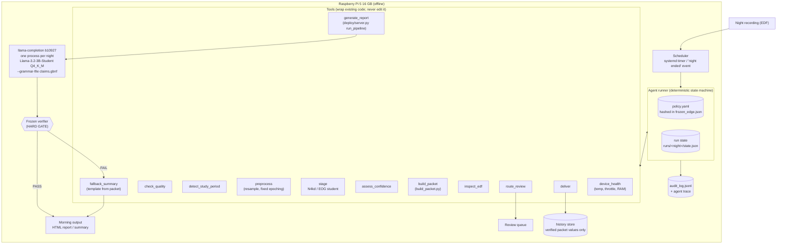
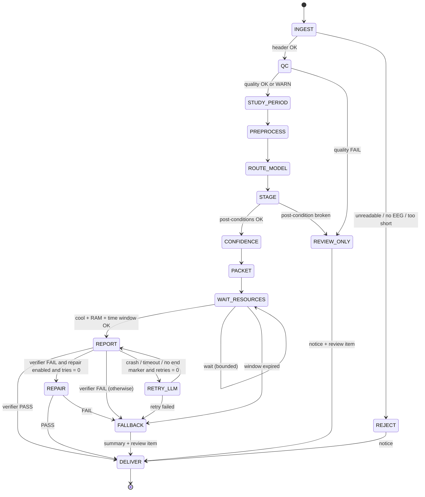
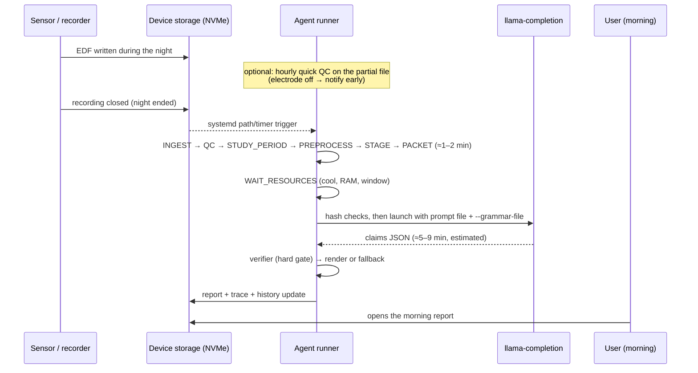

# 02 — System flow: the agentic layer around the existing pipeline

> **Updated 16 Oct (06):** the report runtime is `llama-completion`, one process per night (no resident server, no `/health`, no grammar-in-request). The authoritative bars are in `phase0/ACCEPTANCE.md` and the policy in `phase0/policy.yaml`.

The diagrams are Mermaid. They render on GitHub and in VS Code's Markdown
preview.

## 1. Target architecture



## 2. Agent state machine



**Checkpointing.** Every transition writes `state.json` first. After a power
cut, the runner resumes at the last completed state. The state machine has no
cycles except two bounded ones:
- `WAIT_RESOURCES`: max N waits;
- one LLM retry (crash, timeout or missing end marker only) and, if ever enabled, one repair attempt.

So it **always ends**.

## 3. Each step: inputs, checks, outputs, failure route

| State | Tool (wraps) | Checks (with reason codes) | Output | On failure |
|---|---|---|---|---|
| **INGEST** | `inspect_edf`: `mne.io.read_raw_edf(preload=False)` | `R01` unreadable; `R02` no EEG channel; `R03` duration < 3 h; `W01` Fpz-Cz absent (fallback montage) | channel list, sampling rate, duration, start time | REJECT (R*) or continue with warning (W*) |
| **QC** | `check_quality`: reuses `quality_mask` logic from the advanced trainer | flat/stuck share; clipping share; 50/60 Hz line ratio; amplitude out of range; EOG present and usable. `Q01` > 20% unusable → FAIL; `W02` 5–20% → WARN | quality summary, per-epoch mask | REVIEW_ONLY |
| **STUDY_PERIOD** | `detect_study_period`: **new** (gap G1) | Hypnogram present → use it (as now). Otherwise estimate lights-off/lights-on from first/last sustained low-activity periods, padded like training (see note). `W03` estimated, not annotated. | start/end epoch | Can't fail: worst case, full recording + `W04` |
| **PREPROCESS** | `preprocess`: fixed epoching (`fixed_preprocessing.py` logic) + **resample to 100 Hz** (gap G2); fast path **off** (G10) | 3,000 samples per epoch; no NaN; epoch count within the period | tensor + spectral | REVIEW_ONLY |
| **ROUTE_MODEL** | policy rule | EOG present **and** EOG quality OK **and** EOG model shipped → EOG student; else EEG-only N4kd. `W05` montage ≠ Fpz-Cz. | chosen model + its hash | — |
| **STAGE** | `stage`: `pipeline.infer` or the equivalent for the EOG student | post-conditions: one stage per epoch; probabilities sum to 1 ± 1e-4; no NaN | probabilities `.npz`, decoded hypnogram | REVIEW_ONLY |
| **CONFIDENCE** | `assess_confidence`: night_confidence, N1 flag, reliability tables | `W06` low night confidence; `W07` N1 unreliable | flags into the packet | — |
| **PACKET** | `build_packet` (existing) | schema version; packet re-hashed and stored | packet `.json` + sha256 | REVIEW_ONLY |
| **WAIT_RESOURCES** | `device_health` | SoC temperature < 70 °C; no throttle flags; free RAM > 6 GB; within the report window | — | FALLBACK when the window expires (`F01`) |
| **REPORT** | `generate_report`: check executable, GGUF and grammar sha256; launch `llama-completion` with the frozen arguments (`CONTRACTS.md` §5) and a **subprocess timeout**; then the unchanged verifier and renderer, composed by the agent (**never** `deploy.server.run_pipeline`, which uses `llama-server` and writes into `deploy/`) | verifier PASS; packet hash unchanged; render OK; **V-HTML** | verified HTML | RETRY_LLM (crash/timeout only) / FALLBACK |
| **REPAIR** (optional, option E) | `generate_report(prompt=P2, violations=…)` | verifier PASS | verified HTML | FALLBACK |
| **FALLBACK** | `fallback_summary`: **template only**, filled from packet fields, no generated text | every number copied verbatim from the packet; marked "automatic summary" | HTML summary + review item `F0x` | — |
| **REVIEW_ONLY** | `route_review` | — | review item with reason codes; notice to the user | — |
| **DELIVER** | `deliver` | — | files in `outbox/`; verified values appended to the history store | — |

**Note on G1.** The training data were trimmed from **30 min before the
first sleep epoch to 30 min after the last** (`PRE_POST_WAKE_MIN = 30`; see
`ADDING EOG VERSION - ST NIGHTS/fixed_preprocessing.py`).

`pipeline.py`'s fresh path trims differently: from the first to the last
*annotated* stage, wake included (`_study_period_epochs`). On Sleep-EDF SC
files, that annotated span can include many hours of daytime wake.

**So `detect_study_period` should copy the training rule:**
- **With a hypnogram:** use first sleep − 30 min to last sleep + 30 min.
- **Without one:** estimate first and last sleep from the staging model's own
  output, in two passes:
  1. stage the whole recording;
  2. find the first and last sustained sleep, pad by 30 min, and stage the
     trimmed period again.

Validate the estimator on dev nights against the hypnogram-based period:
- start/end error in epochs;
- effect on TST, sleep efficiency and wake %.

## 4. Decision policy (`policy.yaml`, draft)

Rules are evaluated in order; the first one that matches wins. The file is
hashed into `frozen_edge.json`, so changing a threshold is a visible,
versioned event.

```yaml
version: 0.1-draft
ingest:
  min_duration_h: 3
  eeg_preferred: "EEG Fpz-Cz"
  allowed_fallback_montages: []        # empty = any fallback → REVIEW_ONLY, not just a warning
quality:
  unusable_fail_share: 0.20            # Q01
  unusable_warn_share: 0.05            # W02
  flat_min_s: 1.0                      # same as the trainer's quality_mask
routing:
  eog_model_enabled: false             # true only after Stage 3 + final test sign-off
  eog_min_usable_share: 0.80
resources:
  max_soc_temp_c: 70
  min_free_ram_gb: 6
  report_window: ["01:00", "07:30"]
  max_waits: 12
  wait_s: 300
report:                                # SUPERSEDED: see phase0/policy.yaml
  llm_timeout_s: 1200
  retries: 1                           # crash / timeout / no end marker only
  repair_enabled: false                # true only if the Phase 3 experiment passes its bar
  repair_max: 1
review:
  always_review_if: [Q01, R03, W05, F01, F02, F03]
```

## 5. The run record (agent trace)

There's one JSON line per step, appended to `audit_log.jsonl` next to the
existing entries, with `"_kind": "agent_step"` so the existing entries are
unaffected. An example:

```json
{"_kind": "agent_step", "night_id": "SC4111E0-2026-10-12", "step": 7, "state": "REPORT",
 "tool": "generate_report", "tool_version_sha256": "…", "input_sha256": "packet:…",
 "output_sha256": "html:…", "decision": "DELIVER", "reason_codes": [],
 "verifier": "PASS", "violations": [], "wall_s": 412.6,
 "device": {"soc_temp_c": 63.1, "throttled": "0x0", "free_ram_gb": 10.9},
 "policy_sha256": "…", "manifest": "frozen_edge.json@…"}
```

Two things this gives:
- the whole night can be **replayed and explained step by step**;
- every decision is tied to the policy version that made it.

## 6. Safety invariants (tested in Phase 4)

| # | Invariant | How it is enforced |
|---|---|---|
| I1 | No generated sentence reaches the user without a verifier PASS | Only `REPORT`/`REPAIR` after PASS can produce the HTML report; FALLBACK has no generated text |
| I2 | Every number shown equals a packet field | Verifier (report); verbatim copy (fallback); a test compares them |
| I3 | Frozen components are unchanged | `verify_component_integrity()` before each run, plus the `frozen_edge.json` check |
| I4 | No network access | Agent tool allow-list; no server process (`llama-completion` runs as a local subprocess); on the Pi, the firewall drops outbound traffic |
| I5 | The test split is never read during development | Path allow-list in the agent; a test asserts it |
| I6 | The run always terminates | Bounded loops (§2); per-tool timeouts; global deadline |
| I7 | Every decision is logged with a reason | The runner refuses a transition without a trace entry |
| I8 | Failure is visible | Every non-PASS path writes a review item and a user notice |

## 7. The overnight flow on the device



**Staging during the night (streaming) is optional and separate.**
- N4kd reads windows of 256 epochs with attention in both directions, so
  staging as the night goes would give different, unvalidated predictions.
- Streaming would need its own causal model and its own validation.
- **Recommendation:** for the device, run **QC only** during the night
  (electrode-off alerts), and do the full staging after the recording ends.
