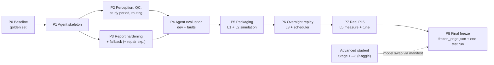

# 04 — Roadmap: from today's pipeline to an agentic system on a Raspberry Pi 5

**Order:** agentic layer first (Phases 0–4, all on the PC), then simulation
(Phases 5–6, on the PC), then the real Pi (Phase 7), then a final freeze
(Phase 8). Effort is in **working days** at a steady pace; calendar time
depends on you.



## Planned folder layout (inside this folder only)

```
AGENTIC AND SIMULATION/
├── README.md, 01_…04_*.md           (these documents)
├── policy.yaml                      (P1; hashed)
├── agent/
│   ├── state.py                     (typed run state, checkpoint save/load)
│   ├── tools.py                     (wrappers over pipeline.py, build_packet.py, deploy/server.py)
│   ├── quality.py                   (P2: QC metrics; reuses quality_mask logic)
│   ├── study_period.py              (P2: training-rule trim, with or without a hypnogram)
│   ├── report_client.py             (P3: llama-completion wrapper: hash checks, subprocess timeout, bounded retry)
│   ├── fallback.py                  (P3: template summary from packet fields)
│   ├── policy.py                    (rule evaluation → decision + reason codes)
│   ├── runner.py                    (state machine, trace, invariants)
│   └── run.py                       (CLI: python -m agent.run --edf … | --inbox …)
├── sim/
│   ├── Dockerfile                   (P5: x86 + arm64)
│   ├── parity.py                    (P5: x86 vs ARM staging/report comparison)
│   ├── replay.py                    (P6: recorder emulator + fault injection)
│   ├── stubs/                       (fake llama-completion executable, fake device_health)
│   └── pi/                          (P7: systemd units, setup.sh, measure.sh)
├── tests/                           (pytest: tools, policy, invariants, scenarios)
└── results/                         (golden set, simulation and Pi measurements)
```

---

## Phase 0 — Baseline and golden set (1–2 days)

**Why:** you can't tell whether the agent or the Pi changed anything without a
fixed reference.

- Run the **current** pipeline on all **31 dev nights**: N4kd →
  `build_packet` → Llama-Student → verifier.
  - **Updated 16 Oct (06):** three labelled references. (1) The frozen packet
    evaluation (the v1 baseline, reproduced exactly, including the one dev
    night that fails). (2) The legacy raw-EDF path, diagnostic only: it can't
    stage a new recording (9 vs 34 spectral features). (3) The corrected
    raw-EDF path, built in P2. Done: `phase0/`, `results/golden/`.
- Store under `results/golden/`, per night:
  - probabilities hash;
  - decoded hypnogram;
  - packet sha256;
  - raw claims;
  - verifier status;
  - timings.
- Write down the **pre-registered bars** for Phases 4 and 7 (copy them from
  `02_SYSTEM_FLOW.md` §6 and `03_EDGE_SIMULATION_PI5.md` §6) **before**
  building anything.

**Exit:** the golden set exists and the bars are written. `git diff` on
existing files is empty.

## Phase 1 — Agent skeleton (3–4 days)

- `state.py`, `runner.py`, `policy.py`, `policy.yaml` v0.1.
- `tools.py` wraps the existing stages **unchanged**, so the agent's happy
  path is today's pipeline.
- Agent trace entries (`"_kind": "agent_step"`) go to a **separate**
  `results/agent_audit.jsonl` during development. The frozen
  `deploy/audit_log.jsonl` isn't touched until the final freeze.
- Checkpoint/resume after a crash.

**Tests:**
- the happy path on 3 dev nights reproduces the golden set **exactly**: same
  packet hash, same claims;
- kill/resume test;
- every transition has a trace entry (I7).

**Exit:** the agent is a drop-in, traced, resumable equivalent of
`pipeline.py`.

## Phase 2 — Perception, QC, study period, routing (4–6 days)

- `quality.py`: flat/stuck (same thresholds as the advanced trainer's
  `quality_mask`), clipping, line-noise ratio, amplitude range, EOG
  usability.
  - **Calibrate** the thresholds on train/val nights: what share of epochs
    is "unusable" on normal nights?
  - Set Q01/W02 so normal nights pass.
- `study_period.py`: the training rule (first sleep −30 min to last sleep +30
  min).
  - With a hypnogram: exact.
  - Without one: two-pass estimate from the staging output.
  - **Validate on dev** against the hypnogram rule: start/end error, and the
    effect on TST, efficiency and wake %.
- Resample to 100 Hz (G2), montage policy (G3), fast path off (G10).
- Routing rule for an EOG model. It stays disabled until the advanced student
  passes Stage 3 and the final test.

**Exit:** dev metrics with the estimated study period are within a written
tolerance of the hypnogram-period metrics. Thresholds are documented with
their calibration data.

## Phase 3 — Report hardening and fallback (3–5 days, plus the optional experiment)

- `report_client.py`:
  - **updated 16 Oct (05, 06):** launch `llama-completion` with the frozen
    arguments, after checking executable, GGUF and grammar sha256;
  - a subprocess timeout, with clean termination;
  - one retry, only on a crash, timeout or missing end marker (never on a
    verifier failure).
- Then the agent composes the unchanged verifier and renderer itself. It never
  calls `deploy.server.run_pipeline` (that uses `llama-server` and writes into
  `deploy/`). V-HTML runs on the final page.
- `fallback.py`:
  - a fixed HTML template filled only with packet values;
  - labelled "automatic summary — full report pending review";
  - a unit test asserting every number shown is a packet field (I2).
- **Optional experiment: repair loop (option E)**, run on dev only.
  - Pre-register the bar first, for example: "turns ≥ 3 of the dev FAILs into
    PASS with 0 new violations elsewhere".
  - New prompt P2: the original prompt plus violation codes plus "fix only
    these claims".
  - Enable it in the policy only if the bar passes.

**Exit:**
- every LLM failure mode ends in a defined state;
- the fallback is tested;
- the repair verdict is recorded, either way.

## Phase 4 — Agent evaluation on the PC (2–3 days)

- All 31 dev nights, through the agent from raw EDF, with no hypnogram given
  (device-like).
- A fault-injection suite with scenarios S1–S15 from
  `03_EDGE_SIMULATION_PI5.md` §5 L3 (stub LLM and stub device health).
- An automatic invariant checker over the traces (I1–I8).

**Exit (pre-registered):**
- 100% of scenarios end in the expected state and reason codes;
- 0 unverified claims shown;
- dev report results not worse than the golden set on nights with
  hypnogram-equivalent periods.

## Phase 5 — Packaging and simulation L1 + L2 (3–4 days)

- `sim/Dockerfile`, one file for both architectures:
  - Python with pinned versions;
  - llama.cpp built from tag b10927;
  - repo mounted read-only.
- **L1:** x86 container with `--cpus=4 --memory=16g --network none`. Run the
  dev nights and record memory and time.
- **L2:** `--platform linux/arm64` (QEMU).
  - Staging parity on all dev nights.
  - SLM parity on 3 dev packets: slow, so run it overnight.

**Exit:**
- the image builds for both architectures;
- staging parity holds;
- 3/3 ARM SLM outputs pass the verifier;
- peak memory ≤ 10 GB.

## Phase 6 — Overnight replay simulator and scheduler (3–4 days)

- `sim/replay.py`: writes dev EDFs into `inbox/` like a recorder, with
  optional accelerated real time, plus fault injection.
- systemd units (`sleep-agent.path`, `.timer`; no LLM server unit), tested
  in the L1 container with systemd, or as a plain loop on Windows.
- `device_health`: real on Linux (`/sys/class/thermal`, `vcgencmd`); stubbed
  for tests.
- History store and the trend note (S15). The trend uses verified packet
  values only.
- Optional: hourly QC on the partial recording (electrode-off alert).

**Exit:** 7 replayed nights in a row in the container, with 0 hangs and all
fault scenarios passing.

## Phase 7 — Real Raspberry Pi 5 16 GB (4–6 days once the board arrives)

- Bring-up checklist (`03_EDGE_SIMULATION_PI5.md` §5 L5): hash-check the
  models first.
- Measurement protocol (§6):
  - `llama-bench`;
  - all 31 dev nights end to end;
  - memory, temperature and power.
- **Parity vs the golden set** on all dev nights, against the pre-registered
  bar.
- Optimisations O1→O5 one at a time, each followed by dev parity. Keep only
  those that pass.
- A 7-night unattended soak.

**Exit:** every Phase 7 acceptance criterion is met, with a measured table
that replaces every **estimate** in the documents.

## Phase 8 — Final freeze (1–2 days)

- `frozen_edge.json`. It **doesn't edit** `deploy/frozen.json`; it references
  it and adds:
  - Pi llama.cpp build (tag + binary sha256);
  - Python lockfile hash;
  - `policy.yaml` hash;
  - staging model hash (N4kd, or the advanced student if it passed);
  - agent code hash;
  - optimisation flags.
- **One** test evaluation on the Pi:
  - the 29 test packets → report, plus the routing and fallback stats;
  - written and logged in the same way as `rescore_test_once.py` and
    `TEST_ACCESS_LOG.md`;
  - the locked test packets are read, never modified (md5 checked before and
    after).
- A short `EDGE_DEPLOYMENT_REPORT.md` with measured results and honest
  limitations.

---

## Dependencies on the ongoing work

| Ongoing work | Effect on this roadmap |
|---|---|
| **Advanced student (Kaggle Stage 1 → 2 → 3)** | It doesn't block Phases 0–7: they use N4kd. If Stage 3 produces a better model, it enters at Phase 8 as a **manifest swap** plus a dev re-check. The EOG routing rule is ready for it. |
| **Label-alignment fix** | The agent's study-period rule uses the *fixed* trimming logic (`fixed_preprocessing.py`), so device nights never have the bug |
| **Llama-Student frozen results (29/29, x86)** | The reference for parity. They aren't re-run or replaced on x86. |

## Total effort (rough)

| Block | Days |
|---|---:|
| Agentic layer (P0–P4) | 13–20 |
| Simulation (P5–P6) | 6–8 |
| Real Pi (P7–P8) | 5–8 |
| **Total** | **≈ 24–36 working days** |

You can order the hardware during Phase 4–5. It isn't needed before Phase 7.

## What not to do

- **Don't let an LLM decide clinical content** or bypass the verifier, even
  "just for a retry".
- **Don't use a free ReAct agent** in the report path: unbounded time on a Pi,
  and not validatable.
- **Don't edit `pipeline.py`, `deploy/server.py`, `report/` or
  `frozen.json`.** Wrap or copy into this folder.
- **Don't treat the x86 29/29 as the Pi result.** Re-validate on the Pi.
- **Don't switch to Ollama or an unpinned llama.cpp** on the device: you'd
  lose hash and version control.
- **Don't run bigger quantisations "because there is 16 GB".** Speed is
  bandwidth-bound, so they're slower.
- **Don't use test data** anywhere before Phase 8.

## Immediate next steps

1. Write down the Phase 4 and Phase 7 pass bars (Phase 0) before any code.
2. Build the Phase 0 golden set on the 31 dev nights.
3. Start Phase 1: the skeleton agent that reproduces the golden set exactly.
