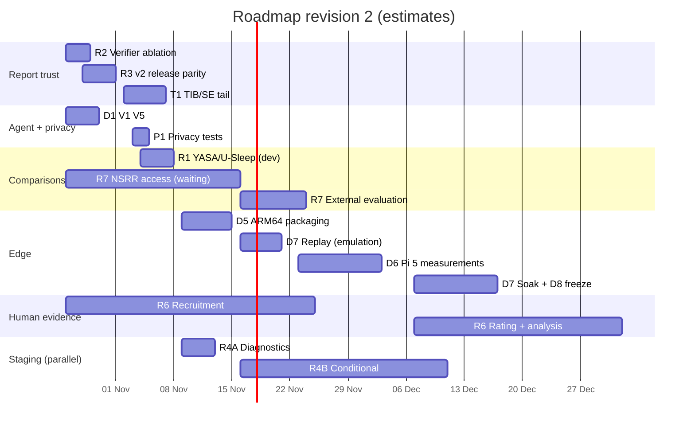

# Roadmap: Trustworthy Path B Report, Then the Edge

**Sleep-Staging · Team 40 · 24 October 2026 · revision 2**

This revision follows the roadmap review of 24 October. **The next milestone is a trustworthy Path B
report on target hardware, not a higher staging score.**

Current state and evaluation rules: [README.md](README.md). Pass/fail bars:
[SYSTEM_ACCEPTANCE.md](SYSTEM_ACCEPTANCE.md).

## Changes from revision 1

| Change | Why |
|---|---|
| **Test set closed for selection.** R1 and R3 now use dev only | The test set has been read several times (README §3) |
| **R3 is release parity**, with v1 kept as the stable release | v2 must not silently replace v1 |
| **New task T1:** the TIB / SE tail on Path B | TIB's tier was measured on hypnogram study periods, not estimated ones. Dev span errors (an upper bound on TIB error) show a tail, and at least one night (SC4111E0) has a large real TIB, TST and SE error (README §5) |
| **The agent stages already built are no longer scheduled.** Only D1, V1, V5 remain before ARM64 | Agent P0–P4 are done (README §4) |
| **Deployment moved forward.** It now follows the report work directly | It tests whether the offline architecture is practical |
| **R4 split into R4A (cheap diagnostics) and R4B (architecture),** with R4B conditional | R4 could consume the whole project |
| **R5 (AASM-feature evidence) deferred** | Sleep-EDF has no spindle or slow-wave annotations to validate against, and the schema shouldn't change during deployment |
| **R6 is now an exploratory study,** with inter-rater agreement | 2–3 raters can't establish clinical effectiveness |
| **R7 has a compatibility protocol**, and no cross-dataset κ comparison | Different montage, cohort and protocol |

**Owners** are left as "TBD" for the team to assign.

**Estimates** are working days for one person. GPU hours come from measured runs: a CV fold takes
79–105 min on a T4, and the report LoRA took 151 min. Calendar time depends on Kaggle quota, NSRR
approval, rater availability and when the Pi 5 board arrives.

---

## 1. Order of work

| # | Task | Priority | Effort | Depends on | Owner |
|---|---|---|---|---|---|
| 1 | **R2** Verifier ablation (dev) | P0 | 2 d CPU | — | TBD |
| 2 | **R3** v2 release parity (dev) | P0 | 2 d + 2.5 GPU-h | — | TBD |
| 3 | **T1** TIB / SE tail on Path B | **Critical** | 3–4 d CPU | — | TBD |
| 4 | **D1** Decide the P1 parity bar | P0 | decision | user | TBD |
| 5 | **V1** Crash tests with the real model | P0 | 0.5 d (~2 h CPU) | D1 | TBD |
| 6 | **V5** Line-noise QC check | P0 | 1 d | — | TBD |
| 7 | **P1** Privacy and security tests | P0 | 1–1.5 d | — | TBD |
| ~~8~~ | **R1** YASA / U-Sleep on dev — **done 28 Oct**: 31/31 nights, project v2 beats YASA on every metric (κ 0.701 vs 0.635; N1 F1 +0.243) | — | — | — | `ROADMAP R1 - YASA COMPARISON/RESULTS.md` |
| 9 | **R6, R7 preparation:** NSRR application, rater recruitment, rating rubric | P1, **start week 1** | 1 d + waiting | — | TBD |
| 10 | **R9** ARM64 packaging → overnight replay → Pi 5 → freeze | P0 | 12–16 d | 1–7; Pi hardware | TBD |
| 11 | **R6** Exploratory clinician study | P1 | 3–4 d + waiting | 9, a frozen release | TBD |
| 12 | **R7** External evaluation | P1 | 5–7 d | NSRR access | TBD |
| 13 | **R4A** Staging diagnostics (Z1–Z6, N3, seeds) | P2, parallel | 2–3 d CPU | — | TBD |
| 14 | **R4B** Staging architecture (Pz-Oz, EMG, N1 loss) | P2, conditional | ~35–45 GPU-h | R4A finding | TBD |
| — | R5 AASM-feature evidence | P3, deferred | — | stable deployment + annotated data | — |
| — | R8 SHHS pretraining · R10 respiratory scope | P4, future | — | — | — |

---

## 2. Tasks

### R2. Verifier ablation (dev)
- **Aim:** measure the errors the gate prevents. Generation succeeding isn't the measure.
- **Arms:** Llama-3.2-3B-Student (v1) on the 31 dev packets, one generation each:
  - **A:** grammar + verifier (current);
  - **B:** grammar, no verifier;
  - **C:** neither.
  The 2G harness already supports the no-grammar arm.
- **Measure per arm:**
  - claims that would have been **released incorrectly**: wrong value, wrong citation, unreliable item
    stated as fact, reliable item hedged;
  - reports missing a mandatory item;
  - reports that fail to parse.
  The frozen verifier is the scorer in every arm; it decides what reaches the reader only in arm A.
- **Effort:** 2 days; about 3 h CPU per arm.
- **Done when:** a table of incorrect-release counts per arm, with the definitions fixed before the run.

### R3. v2 release parity (dev)
- **Aim:** a v2 release that works on its own packets. It is not aimed at a test score.
- **Work:**
  - LoRA-retrain the report model on the existing v2 training set
    (`PIPELINE INTEGRATION/results/trainset_n6adv/`, 123 + 14);
  - convert to GGUF;
  - write `agentic/config/releases/v2.yaml` and the EOG staging adapter (pending item M2).
- **Acceptance:**
  1. works on the v2 packet schema;
  2. passes the full verifier test suite;
  3. meets the dev bar fixed before the run (≥ 30/31 at 5/5, 0 violations);
  4. deterministic on `llama-completion`;
  5. model, packet, prompt, verifier and runtime versions recorded together in the manifest.
- **Not done:** no test-set run to "restore 29/29". v1 stays the stable release.
- **Effort:** 2 days + ~2.5 GPU-h.

### T1. TIB / SE tail on Path B
- **Aim:** stop the packet stating TIB as fact on nights where the estimated night boundaries are
  unreliable, while keeping the frozen verifier rules.
- **Steps:**
  1. **Resolve the SC4111E0 discrepancy.** It has a 316-epoch end error in `p2_calibration.json`, but is
     missing from P2_STATUS's list. Check whether its reference span includes a nap.
  2. **Recompute on train.** Using Path B's estimated study periods on the 137 train nights, compute TIB
     and SE errors against the reference periods.
  3. **Recalibrate the tiers on train,** for TIB and SE separately, with the existing rule.
  4. **Design a separate boundary-uncertainty signal** on train, distinct from staging uncertainty. For
     example: end-of-period wake/sleep run structure, agreement between the two staging passes,
     distance from the end of the recording. Fix its threshold on train.
  5. **Freeze it,** then evaluate once on dev and report:
     - the share of large TIB errors (> 30 min) detected;
     - the false-review rate;
     - the coverage of reliable TIB;
     - SE reliability under the same conditions.
  6. **Act through the packet, not the verifier.** A flagged night either gets a TIB item with the
     tier its error deserves (so the existing rules require hedging), or goes to review.
  7. **Release it as its own version** (v1.1 or similar), with an ACCEPTANCE change-log entry.
- **Don't:** lower the W08 threshold until it catches the dev nights.
- **Effort:** 3–4 days CPU. Step 6 changes how the packet is built, so the v1 report model must be
  re-checked on dev against the new packets.

### D1, V1, V5. Remaining pre-ARM agent work
- **D1:** decide the P1 parity bar (`PENDING.md`). Option A, re-baseline on this machine, is
  recommended.
- **V1:** run `agentic/tests/test_crash_recovery.py --backend llama`, about 2 h.
- **V5:** a 50/60 Hz line-noise ratio, calibrated on train and added to the QC policy as a new policy
  version.

### P1. Privacy and security
Write `PRIVACY.md` and tests for:
- **Network isolation:** run Path A and Path B with networking disabled. The run must succeed, and a
  socket monitor must see no outbound connection attempts.
- **Temporary-file cleanup:** after delivery, and after a crash and resume.
- **Logs:** audit of audit and trace contents, redacting or hashing identifiers if needed.
- **Storage and permissions** on the device.
- **A deployed image without the reference runner or `.env`.**

**Effort:** 1–1.5 days.

### R1. YASA and U-Sleep on dev
- **Work:** pretrained models only, no tuning, on the 31 dev nights. Use the same labels (corrected),
  epoch alignment and study period for all three models. Write a channel-mapping note.
- **Not done:** no test run.
- **Effort:** 2–3 days CPU.
- **Done when:** a three-way table of κ, macro-F1 and per-stage F1 on identical nights.

### R9. Edge deployment (D5–D8; D1–D4 are done)

| Stage | Work | Effort | Exit |
|---|---|---|---|
| D5 ARM64 packaging | Docker x86 and ARM64 images; pinned llama.cpp b10927, model files, Python dependencies, arguments; offline build | 3–4 d | x86 vs ARM64 parity on the golden set; runs with no network |
| D6 Pi 5 measurements | End-to-end, staging, packet and LLM time; peak RAM; temperature; throttling; energy | 4–6 d once the board arrives | Measured scorecard |
| D7 Overnight replay and soak | Multiple full nights; the 15 fault scenarios; restart and resume | 3–4 d | Exactly one delivered artifact per recording; invariants I1–I8 hold |
| D8 Final freeze | `frozen_edge.json`, a parity check, the published scorecard | 1–2 d | All edge rows of SYSTEM_ACCEPTANCE met |

**Estimated end-to-end latency on the Pi 5,** to be replaced by measurements:

| Step | Estimate |
|---|---|
| Preprocess + staging | seconds to ~1 min |
| Packet | seconds |
| Report generation | 266–380 s (floor, `03_EDGE_SIMULATION_PI5.md`) |
| Verify + render | seconds |

**If the board is late,** D5 and D7 run on ARM64 emulation first, and only D6 and D8 wait.

**Study-period estimator v0.3, accepted with a deviation, carried into deployment:**
- frozen as is;
- endpoint-error distribution and problem nights preserved;
- uncertain endpoints handled by T1;
- no further tuning on dev;
- v0.4 would be a separate, versioned improvement.

### R6. Exploratory clinician study
- **Raters:** 2–3 clinicians or sleep technologists, rating about 20 dev nights.
- **Conditions:**
  - blinded to the generation method;
  - randomised order;
  - a fixed rubric scoring factual correctness, clarity, usefulness and appropriate caution separately.
- **Comparator:** the R2 arm C output, as an experimental comparator for the verification
  architecture. It is not a clinical baseline.
- **Report:** individual ratings, inter-rater agreement (for example Krippendorff's α) and
  uncertainty, not only means.
- **Framing:** exploratory; no claim of clinical effectiveness.
- **Effort:** 3–4 days + 2–4 weeks waiting for raters.

### R7. External evaluation
**Protocol, written before access:**
1. a channel compatibility table;
2. the preprocessing and resampling pipeline;
3. a missing-channel policy;
4. a label that separates a true like-for-like input from a modified montage, for example a central
   lead in place of Fpz-Cz;
5. no retraining or threshold tuning on the external cohort.

**Work:** run the staging model and the full Path B, unchanged. Report staging κ and the report
outcomes with the README §4 denominators.

**Not done:** no direct comparison with SleepVLM's or SleepFM's figures.

**Effort:** NSRR access 1–3 weeks of waiting (apply in week 1), then 5–7 days.

### R4A and R4B. Staging (parallel track)
- **R4A, CPU only:**
  - Z1 missing/noisy channel;
  - Z2 overlap inference;
  - Z3 N1 error anatomy;
  - Z4 per-class calibration;
  - Z5 seed averaging;
  - Z6 ONNX latency;
  - the N3 check.
  Effort: 2–3 days.
- **R4B, only for a limitation R4A identifies:**
  - Pz-Oz early fusion;
  - chin EMG;
  - N1 loss;
  - replication.
  The bars and protocol are in `ADDING EOG VERSION - IMPROVEMENT ROADMAP/ROADMAP.md`. About 35–45 GPU-h.
- **The B1 benchmark** (standard Sleep-EDF-78 protocol, ~7–8 GPU-h) runs once, on whatever configuration
  is final.
- **Expected results are hypotheses:** for example "84–85 %, κ 0.78–0.79". They are not forecasts.
- **R4 never delays the deployment milestones.**

---

## 3. Timeline

Week 1 starts **Monday 26 October 2026**.

| Period | Main focus | Deliverable |
|---|---|---|
| 26 Oct – 8 Nov | R2, R3, T1, D1/V1/V5, P1, R1; NSRR + rater applications sent | Ablation table; v2 dev acceptance; TIB/SE tail release; real-model crash tests; privacy tests; baseline table |
| 9 – 22 Nov | D5 ARM64 packaging; D7 replay on emulation; R4A on CPU | Reproducible offline ARM64 application |
| 23 Nov – 6 Dec | D6 Pi 5 measurements (if the board is here); R7 if access granted | Runtime, memory, thermal report; external results |
| 7 – 20 Dec | D7 soak on the Pi; D8 freeze; R6 rating sessions | Frozen edge release; rater data |
| 21 Dec – 8 Jan | Buffer, holidays, R6 analysis, final evaluation package | Final package, subject to access and availability |

**Totals (estimates):**
- **Must-do set** (R2, R3, T1, D1/V1/V5, P1, R1, R9): about **26–33 working days**.
- **With R6, R7 and R4A:** about **36–47 working days**.

The plan fits the 10 calendar weeks to 8 January 2027 only if NSRR access, raters and the Pi 5 arrive
on time. If any is late, its item moves; the rest still finishes. Everything from R4B on is outside
the committed dates.

---

## 4. Risks

| Risk | Mitigation |
|---|---|
| The Pi 5 board arrives late | D5 and D7 run on ARM64 emulation; only D6 and D8 wait |
| T1 can't separate bad-boundary nights | Report the detection rate honestly; route TIB on unflagged Path B nights to hedged wording if the train evidence supports it |
| v2 retrain misses the dev bar | v1 remains the release; record v2 as not accepted |
| NSRR access refused or slow | Report external validation as not done; no substitute claims |
| Raters unavailable | Run with available technologists; report as a limitation |
| R4B takes GPU time from R3 | R3 runs first (2.5 GPU-h); R4B uses leftover quota |

## 5. What not to do

- **Don't select, tune or retrain on the test set.** Further reads are labelled and logged.
- **Don't loosen a verifier rule,** and don't let the model write free text.
- **Don't lower W08,** or any threshold, by looking at dev.
- **Don't compare κ across datasets** with different protocols.
- **Don't let staging work delay the deployment milestones.**
