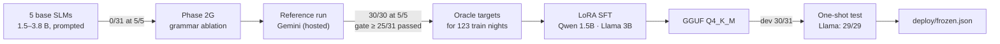
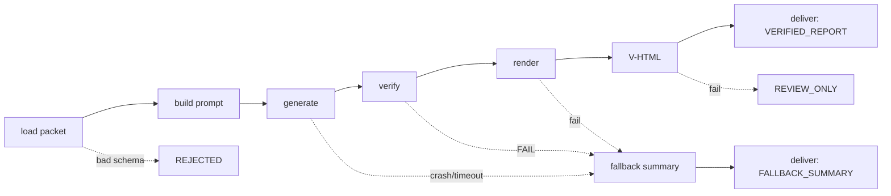

# Pipeline Flow: Input → Process → Output, Phase by Phase

**Sleep-Staging · Team 40 · written 20 October 2026**

This is the map of the whole project as one flow. For each phase it lists **what goes in**, **what
happens to it**, and **what comes out**, with the file that does the work and the file it writes. All
examples are real: they come from recording `SC4081E0-PSG` (a dev night) and the files named next to
them.

The detailed records are elsewhere (see §10). This file only connects them.

> **Phase names.** The project's own documents call the staging and verifier work "Phase 1" and the
> language-model work "Phase 2". The later stages (deployment, the EEG + EOG upgrade, the agent) have no
> official number; they are numbered 3–5 here for convenience.

---

## 1. The whole flow on one page

```mermaid
flowchart LR
    A["Raw PSG night<br/>.edf + hypnogram .edf"] --> P0["Phase 0<br/>Preprocess"]
    P0 -->|"tensor [N×3000]<br/>spectral [N×34]<br/>labels"| P1a["Phase 1a<br/>Teacher ENSmc"]
    P1a -->|"soft labels<br/>(teacher logits)"| P1b["Phase 1b<br/>Student N4kd (KD)"]
    P0 --> P1b
    P1b -->|"per-epoch probs [N×5]"| P1c["Phase 1c<br/>Calibrate + reliability tables"]
    P1c -->|"T, decoder, N1 flag,<br/>night tiers, metric tiers"| P1d["Phase 1d<br/>Evidence packet"]
    P1b --> P1d
    P1d -->|"packet.json<br/>19 evidence items"| P2["Phase 2<br/>Report SLM<br/>Llama-3.2-3B-Student"]
    P2 -->|"JSON claims"| V{"Phase 1e<br/>Verifier<br/>30 rules"}
    V -->|PASS| R["HTML report"]
    V -->|FAIL| H["human review /<br/>fallback summary"]
```



In one sentence: **a night of EEG becomes a stage label for every 30 s, those labels become numbers
with known error bars, the numbers become a packet, a small language model turns the packet into
structured claims, and a deterministic verifier lets a report through only if every claim checks out.**

### Data used at every phase

| Split | Recordings | Used for |
|---|---:|---|
| Train | 137 | training the staging models; 123 + 14 of them train the report model |
| Validation / dev | 31 | fitting every table (calibration, thresholds, tiers); measuring the report model |
| Test | 29 | **locked**: read once at the end, checksum-verified, never used to choose anything |

Source: 197 Sleep-EDF Expanded recordings (SC = healthy, ST = temazepam study). Splits are by subject,
so no person appears in two splits (`distillation/cohort_split.json`).

---

## 2. Phase 0: Preprocessing (raw EDF → tensors)

| | |
|---|---|
| **Input** | `SC4081E0-PSG.edf` (the polysomnogram: EEG, EOG, EMG… at 100 Hz) and `SC4081EC-Hypnogram.edf` (the expert's stage annotations) |
| **Process** | Read with MNE → pick EEG Fpz-Cz → map annotations to W / N1 / N2 / N3 / REM (R&K stages 3 + 4 → N3; "Movement time" and "?" dropped) → trim to 30 min of wake either side of sleep → cut into 30-second epochs (3000 samples each) → compute 34 spectral features per epoch: 24 wavelet (db4, level 5: energy, log-energy, entropy, variance × 6 coefficient sets) + 7 STFT (relative δ θ α β γ power, spectral entropy, 95 % edge frequency) + 3 band ratios (δ/β, θ/α, (δ+θ)/(α+β)) |
| **Output** | `processed_sleepedf/tensors/<id>.pt` — tensor **[N epochs × 3000]**<br/>`processed_sleepedf/spectral/<id>_spectral.pt` — tensor **[N × 34]**<br/>`processed_sleepedf/index.csv` — one row per night: tensor path, stage sequence, spectral path |
| **Code** | `code/Phase1_48/Phase1reworked/preprocess.py`, `code/Phase1_48/Phase1reworked/spectral_preprocess.py`, `distillation/preprocess_multichannel.py` (adds EOG + Pz-Oz → `processed_sleepedf_mc/`, shape `[N × 3 × 3000]`) |

Example: `SC4001E0-PSG.pt` has shape `[841, 3000]` = 841 epochs ≈ 7 h.

> **Known fault (found 11 Oct):** the trimming removed unscored epochs from the labels but not from the
> signal, so labels drift one epoch per removed epoch. 5–7 % of labels are affected. Corrected labels
> live in `ADDING EOG VERSION - ST NIGHTS/results/`. See `README_FOR_CODE_REVIEW.md` §11.

---

## 3. Phase 1: The staging model and the deterministic tier

### 1a. Teacher (ENSmc)

| | |
|---|---|
| **Input** | train tensors + spectral features + labels |
| **Process** | Train three EEG models of the same family, then average their softmax outputs: `student_N2multiscale_fix` (EEG), `student_N3mc_s42` (EEG + EOG + Pz-Oz), `student_baseline_E0` (single-scale) |
| **Output** | teacher probabilities per epoch (`cache_teacher_logits.py`) — the "soft labels" for distillation. Test: κ 0.7140, accuracy 78.68 % |
| **Code** | `distillation/build_ensemble.py`, `distillation/cache_teacher_logits.py` |

### 1b. Student (N4kd) — the staging model that ships

| | |
|---|---|
| **Input** | the same tensors + spectral features, **plus** the teacher's soft labels |
| **Process** | Model sees a window of 256 epochs (~2 h). Each epoch → fine CNN branch (0.5 s kernels: spindles, K-complexes) + coarse branch (2 s kernels: slow waves) + spectral encoder → fused 64-d vector → 2-layer Transformer across epochs → 5-class head. Loss = 0.5 × KD(T = 3) + 0.5 × class-weighted cross-entropy. 75 epochs, best at 69. |
| **Output** | `distillation/results/students/student_N4kd/student_best.pt` — **139,606 parameters**, 4.65× smaller than the teacher. Per-epoch probabilities **[N × 5]**. Test κ 0.6993 as shipped (0.7169 on corrected labels) |
| **Code** | `distillation/student_model.py`, `distillation/train_student.py`, `distillation/kaggle_train_student_kd.py` |

### 1c. Calibration and reliability tables (fitted on validation only)

These turn raw probabilities into numbers whose trustworthiness is *known*.

| Table | What it answers | Value for N4kd | File |
|---|---|---|---|
| Temperature | how to make confidence match accuracy | T = 1.2847 | `reliability_table.json` |
| Sequence decoder | how to remove isolated stray REM epochs | REM min-run 3 | `results/sequence_decoding.json` |
| N1 flag | which N1 calls are low-confidence | max prob < 0.575 | `results/n1_flag.json` |
| Night confidence | is this whole night easy or hard? | entropy tertiles: high ≤ 0.608, medium ≤ 0.698 nats | `results/night_confidence.json` |
| Derived-metric reliability | which clinic numbers can be stated plainly | 3 robust, 12 fragile, 9 unreliable | `results/derived_metric_reliability.json` |

**Input:** validation-set probabilities + labels. **Output:** the five JSON tables above.

### 1d. Evidence packet (probabilities → one JSON file per night)

| | |
|---|---|
| **Input** | the night's probabilities from 1b + the tables from 1c |
| **Process** | calibrate → decode the hypnogram → compute clinic metrics (TST, efficiency, latencies, stage fractions…) → attach each metric's validation error and reliability tier → pick the night's confidence tier → flag low-confidence N1 epochs → add Integrated-Gradients attribution → list the **19 evidence items** a report may talk about |
| **Output** | `distillation/results/phase2_dev_packets/SC4081E0-PSG.json` (schema 1.3). 137 train / 31 dev / 29 test packets |
| **Code** | `distillation/build_packet.py` |

What a packet contains (real values, SC4081E0):

```
hypnogram.predicted_stages   1134 labels (W, N1, …)        decoded, 2 epochs changed vs argmax
per_stage.N1                 72 epochs, mean confidence 0.62, reliability LOW
derived_metrics              Total_Sleep_Time 24600 s, Sleep_Efficiency 0.7635, REM_Latency 13650 s …
night_confidence.tier        "high"  (mean entropy 0.432 nats)
evidence_items[19]           the only facts a report may cite
```

One evidence item:

```json
{"id": "arch.rem_latency", "label": "REM latency", "value": 227.5, "unit": "minutes",
 "metric_reliability": "unreliable", "safe_to_assert": false, "mean_abs_error": 48.2,
 "caveat": "depends on a single epoch. ..."}
```

The 19 items split into **5 mandatory** (stated plainly) and **14 hedged** (stated with error + caveat):

| Mandatory — must be stated as fact | Hedged — must carry error and caveat |
|---|---|
| total sleep time, time in bed, sleep efficiency, night confidence tier, N1 reliability warning | sleep onset latency, WASO, REM latency (×2), REM periods, stage transitions, transition rate, light/deep ratio, wake interruptions/h, fraction of W, N1, N2, N3, REM |

### 1e. The deterministic report tier (frozen)

| Part | Input | Output | File |
|---|---|---|---|
| Claim schema | — | the allowed shape of a claim: `value`, `hedged_value`, `observation`, `review_flag`, `population_association` | `report/claim_schema.py`, `reference/response_schema.json` |
| Grammar | — | a GBNF grammar that makes malformed claims impossible to generate | `report/claims.gbnf` |
| Verifier | claims + packet | PASS, or a list of violations. **Layer 1** checks shape (valid JSON, known fields, unique IDs). **Layer 2** checks every claim against the packet: cited value matches exactly, safe items stated plainly, unsafe items hedged, all 5 mandatory items present. 30 rejection codes. Never infers missing evidence. | `report/verify_structure.py`, `report/verify_policy.py` |
| Renderer | verified claims | English sentences from fixed templates; HTML page. Runs only at zero violations. | `report/render.py` |

---

## 4. Phase 2: The report language model (packet → claims)

The question: can a model small enough for a Raspberry Pi turn a packet into claims that pass the
verifier?



| Step | Input | Process | Output | Where |
|---|---|---|---|---|
| 2a. Candidates | 31 dev packets + prompt P1 | 5 small models (Qwen 1.5B, SmolLM2 1.7B, Gemma-2 2B, Llama-3.2 3B, Phi-3.5) generate claims under the grammar; the verifier scores them | **0/31** reports at 5/5 for every model; only 1 wrong number in 155 reports — they fail the rules, not the arithmetic | `candidates/` |
| 2G. Ablation | same, grammar removed | measure what the grammar contributes | grammar is needed for valid syntax, not enough for correct semantics | `report/PHASE2G_ABLATION.md` |
| 2b. Reference | same packets, same prompt, same verifier | a large hosted model (Gemini) as a ceiling test | **30/30** at 5/5, 0 violations → contract is satisfiable → pre-registered rule says **train** | `reference/` |
| 2c. Training set | 137 train packets → reference model | oracle claim sets for each night | 123 train + 14 validation examples | `student/build_set.py`, `student/trainset/` |
| 2d. Distillation | the 137 examples | LoRA SFT on Kaggle T4: rank 16, α 32, lr 2e-4, 3 epochs; merge → quantise to Q4_K_M | `llama-3.2-3b-instruct-student-q4_k_m.gguf` (2.0 GB), Qwen equivalent | `student/kaggle_sft.py` |
| 2e. Evaluation | dev (31), then test (29) once | same harness as 2a | **Llama-Student: dev 30/31, test 29/29**, 0 violations, numeric fidelity 1.000. Qwen-Student: test 12/29 (fails on high/medium nights) | `candidates/results/` |

What the model outputs (real, `candidates/cache/Llama-Student/P1/`):

```json
{"claim_id": "c2", "claim_type": "hedged_value", "cites": ["arch.rem_latency"],
 "subject": "this_recording", "value": 119.0, "unit": "minutes"}
```

What the renderer turns a verified claim into (real, `deploy/reports/SC4081E0-PSG_2026-10-05.html`):

> *Total sleep time: 410 minutes.*
> *REM latency: 227.5 minutes, mean absolute error 48.2097 minutes on the validation split. Caveat:
> depends on a single epoch. …*

The model never writes these sentences. It only picks the claim type and citation; the template writes
the English.

---

## 5. Phase 3: Deployment (one new night, end to end)

| | |
|---|---|
| **Input** | one raw `.edf` (+ hypnogram if available, to find the study period) |
| **Process** | `pipeline.py`: **1** preprocess → tensor · **2** N4kd inference → probabilities · **3** build packet · **4** packet → local Llama server (grammar-constrained, temp 0, seed 0) → verifier |
| **Output** | PASS → `deploy/reports/<id>_<date>.html`. FAIL → `deploy/human_review/`. Every run appended to `deploy/audit_log.jsonl` |
| **Pinned by** | `deploy/frozen.json` (model file + SHA-256, generation settings, recorded test result) |

```
python pipeline.py --edf path/to/SC4081E0-PSG.edf
```

Cost per report on CPU: ~115 s, 4.7 GiB peak memory (Llama-Student).

> **Caveat:** running the model through `llama-server` (what `pipeline.py` and `deploy/server.py` do)
> gives lower quality than the frozen evaluation path `llama-completion` (20–23/31 vs 30/31 on dev).
> The verifier still blocks every bad report. See `ADDING EOG VERSION - PIPELINE INTEGRATION/README.md`.

---

## 6. Phase 4: EEG + EOG upgrade (better staging, same report path)

| Step | Input | Process | Output |
|---|---|---|---|
| Label fix | raw hypnograms | re-align labels to signal | corrected labels; N4kd re-scored once: 77.69 % → 79.00 % |
| Advanced student | EEG + horizontal EOG, corrected labels | N4kd backbone + gated EOG branch + time-frequency branch + local conv; gates start closed so it begins as N4kd | `student_N6adv_full_s1`: **175,599 params, test 81.96 %, κ 0.7557** (beats the teacher with 43 % of its size) |
| Integration | new model's probabilities | refit all 1c tables on validation, rebuild packets (schema unchanged) | frozen report model on new packets, not retrained: **dev 30/31, 0 violations; test 27/29, 1 night blocked by the verifier** (N4kd packets: 29/29) |

Folders: `ADDING EOG VERSION*` (see `ADDING EOG VERSION - FINAL SUMMARY/README.md`).

---

## 7. Phase 5: The agent around the pipeline

The agent decides **what to do** (check, retry, fall back, deliver, audit). It never decides **what is
true**: stages come from the staging model, numbers from the packet, and every claim passes the frozen
verifier.

| | |
|---|---|
| **Input** | a packet (Path A) or a raw EDF with no hypnogram (Path B) |
| **Process** | deterministic state machine: ingest → quality check → study period → preprocess → stage → confidence → packet → wait for resources → report → verify → render → V-HTML (every number on the page must trace to the packet) → deliver. One retry only on crash/timeout, never on a verifier failure |
| **Output** | exactly one of four outcomes in `agentic/runtime/outbox/`: **VERIFIED_REPORT**, **FALLBACK_SUMMARY** (deterministic summary, no generated text), **REVIEW_ONLY**, **REJECTED**. Non-verified outcomes also write to `runtime/review/` |
| **Run** | `python -m agentic run-packet <packet.json>` · `python -m agentic run-edf <night.edf>` |



Details: `agentic/README.md`, `AGENTIC AND SIMULATION/02_SYSTEM_FLOW.md`.

---

## 8. Hand-off summary (what each phase passes to the next)

| From → To | Artifact | Shape / format |
|---|---|---|
| Raw → 0 | `.edf` PSG + hypnogram | EDF, 100 Hz |
| 0 → 1a/1b | tensor, spectral, labels | `[N×3000]`, `[N×34]`, `N` labels |
| 1a → 1b | teacher soft labels | `[N×5]` probabilities |
| 1b → 1c/1d | student probabilities | `[N×5]` |
| 1c → 1d | reliability tables | 5 JSON files |
| 1d → 2 | evidence packet | JSON, schema 1.3, 19 evidence items |
| 2 → 1e | claims | JSON array, grammar-constrained |
| 1e → user | report | HTML, or human review |

## 9. Rules that hold across every phase

- **Test set locked.** 29 nights, read once at the end; checksum `050fffe4…dd92` unchanged.
- **Every table is fitted on validation**, never on test.
- **The deterministic tier is frozen** while models are compared against it.
- **One generation per night**, temperature 0, no retries for quality, no best-of-N.
- **Decision rules written before results** (e.g. "≥ 25/31 at 5/5 → train").

## 10. Where to read more

| Topic | Document |
|---|---|
| Current state, all verified numbers | `README_FOR_CODE_REVIEW.md` |
| Phase 2 in plain language | `report/README_PHASE2_OVERVIEW.md` |
| Schema, grammar, verifier, renderer | `report/README.md`, `report/PHASE1_REPORT.md` |
| Staging models and distillation | `PROJECT_REPORT.md`, `TEACHER_MODEL_REPORT.md` |
| Trained report models | `student/slm_models/SLM_FINDINGS_REPORT.md` |
| EEG + EOG upgrade | `ADDING EOG VERSION - FINAL SUMMARY/README.md` |
| Agent | `agentic/README.md` |
