# VERIFIED ON-DEVICE SLEEP REPORTING: KNOWLEDGE-DISTILLED SLEEP STAGING, EVIDENCE PACKETS, A FINE-TUNED SMALL LANGUAGE MODEL AND AN AGENTIC EDGE PIPELINE

**A PROJECT REPORT**

Submitted in partial fulfillment for the Degree of Bachelor of Technology under the School of Computing

**Submitted by**

| Register No | Name of Student |
|---|---|
| <Roll no here> | <Name here> |
| <Roll no here> | <Name here> |
| <Roll no here> | <Name here> |

DEPARTMENT OF COMPUTER SCIENCE AND ENGINEERING
AMRITA VISHWA VIDYAPEETHAM, Amritapuri Campus (INDIA)
November 2026

---

## BONAFIDE CERTIFICATE

This is to certify that this is a bonafide record of the project presented by the students whose names
are given below during Project Phase I (22AIE498) in partial fulfilment of the requirements of the degree
of Bachelor of Technology in Computer Science and Engineering (Artificial Intelligence).

| Roll No | Name of Student |
|---|---|
| <Roll no here> | <Name here> |
| <Roll no here> | <Name here> |
| <Roll no here> | <Name here> |
| <Roll no here> | <Name here> |

<Guide's Name> (Project Guide) · <Coordinator name> (Project Coordinator), Designation ·
<Reviewer's Name> (Reviewer), Designation

---

## Contents

- Acknowledgements
- List of Figures
- List of Tables
- Abstract
- 1 Introduction — 1.1 Background · 1.2 Problem Addressed · 1.3 Motivation · 1.4 Scope of the Project
- 2 Literature Review / Existing System — 2.1 Existing System Study · 2.2 Research Gap · 2.3 Problem Statement and Contributions · 2.4 Novelty of the Proposed Work
- 3 Proposed Work — 3.1 Proposed Work · 3.2 Methodology (3.2.1–3.2.8)
- 4 Experimentation and Result Analysis — 4.1–4.8
- 5 Conclusion and Scope for Further Research
- Appendix A — Code, Configuration and Reproduction
- References

---

## Acknowledgements

<Write your acknowledgements here.>

(YOUR NAME IN CAPS)

---

## List of Figures

Paths are relative to this folder. Figures in `figures/output_v2/` are the corrected versions for
release v2; figures in `figures/output/` are original v1-era figures that remain valid as history.

| No. | Title | File |
|---|---|---|
| 3.1 | System overview: five stages plus the agent | `../figures/output_v2/F33_system_overview.png` |
| 3.2 | Subject-level train / validation / test split | `../figures/output_v2/F1_subject_split.png` |
| 3.3 | Encoder receptive field (0.25 s → 8.75 s) | `../figures/output/F5_receptive_field.png` |
| 3.4 | Block-wise architecture of the staging student | `../distillation/figures/fig_blockwise_architecture.png` |
| 4.1 | Exposure gradient: what the inherited model had memorised | `../figures/output_v2/F3_exposure_gradient.png` |
| 4.2 | Teacher ladder (E0 → E1a → E1b) | `../figures/output/F6_teacher_ladder.png` |
| 4.3 | Why naive KD failed: the distillation mechanism | `../figures/output/F11_kd_mechanism.png` |
| 4.4 | KD penalty against teacher quality | `../figures/output/F12_penalty_vs_teacher.png` |
| 4.5 | Calibration transfer through distillation | `../figures/output/F13_calibration_transfer.png` |
| 4.6 | Model size against κ, v1 vs v2 on the same labels | `../figures/output_v2/F14_params_vs_kappa.png` |
| 4.7 | Architecture ablation (5-fold CV, same labels) | `../figures/output_v2/F26_architecture_ablation.png` |
| 4.8 | Confusion matrix, release v2, held-out test | `../figures/output_v2/F15_confusion_matrix.png` |
| 4.9 | Per-class F1, v2 vs v1, held-out test | `../figures/output_v2/F16_per_class_f1.png` |
| 4.10 | Robustness to a missing EOG channel | `../figures/output_v2/F27_missing_channel_robustness.png` |
| 4.11 | B1 benchmark per-fold κ | `../figures/output_v2/F17_b1_folds.png` |
| 4.12 | B1 against published models | `../figures/output_v2/F18_b1_vs_published.png` |
| 4.13 | Derived-metric reliability (robust / fragile / unreliable) | `../figures/output_v2/F30_metric_reliability.png` |
| 4.14 | Report verification across releases and splits | `../figures/output_v2/F25_report_verification.png` |
| 4.15 | Verifier ablation | `../figures/output_v2/F20_verifier_ablation.png` |
| 4.16 | Real recordings end to end (Path B) | `../figures/output_v2/F29_real_recordings.png` |
| 4.17 | Signal-quality checks and line noise | `../figures/output_v2/F31_quality_checks.png` |
| 4.18 | Night boundaries found without an expert | `../figures/output_v2/F32_night_boundaries.png` |
| 4.19 | Same-night comparison with YASA | `../figures/output_v2/F28_vs_yasa.png` |

Interactive architecture, workflow and data-flow diagrams of the codebase are under
`../.archify/` (HTML, release v1 code paths at commit `0395775`).

## List of Tables

| No. | Title |
|---|---|
| 2.1 | Published sleep-staging models on Sleep-EDF-78 |
| 2.2 | LLM-based sleep and EEG reporting systems |
| 2.3 | Established techniques vs what is new in this work |
| 2.4 | Feature comparison with related papers and tools |
| 3.1 | Dataset and split summary |
| 3.2 | Staging student (release v2) parameter budget |
| 3.3 | Evidence packet schema 1.3 (top-level fields) |
| 3.4 | Report-model training configuration |
| 3.5 | Agent outcomes and reason codes |
| 3.6 | Tools and technologies |
| 4.1 | Knowledge-distillation experiments (v1, stored labels) |
| 4.2 | Release v2 staging, held-out test (corrected labels) |
| 4.3 | Architecture ablation, 5-fold CV |
| 4.4 | B1 standard benchmark |
| 4.5 | Evidence-packet calibration and night confidence (v2) |
| 4.6 | Report-model selection (dev and test) |
| 4.7 | Verifier ablation |
| 4.8 | Agentic fault scenarios |
| 4.9 | Edge-device time and memory budget (analytical) |
| 4.10 | Comparative analysis |
| 4.11 | Head-to-head scorecard against the best existing work |

---

## Abstract

Overnight sleep staging is the basis of every sleep report, yet the two halves of automated reporting
are rarely built together: compact staging models stop at a hypnogram, and language-model reporting
systems check their output, if at all, only after it has been written. This project builds and
evaluates the full chain, offline, in six stages: knowledge distillation, a compact staging student, a
structured evidence packet, a fine-tuned small language model (SLM), an agentic workflow and an
edge-device simulation.

**Knowledge distillation.** Auditing the inherited 649,229-parameter model showed its reported Cohen's κ
of 0.6663 came from a recording-level split that leaked subjects; on an unseen subject it scored 0.5066
and never identified N3. With subject-level splits, distillation from single teachers *hurt* the student,
which exposed the mechanism that a teacher must exceed the student's own undistilled performance before
its soft targets help. Widening the encoder's receptive field from 0.25 s to 8.75 s and distilling from a
three-model ensemble (412,311 parameters) fixed both problems. A label-alignment bug affecting 5–7% of
Sleep-EDF epochs was then found and corrected.

**Student model.** The released student (v2) is a 175,599-parameter EEG + EOG network distilled from that
ensemble with gated EOG and time-frequency branches. On 15 held-out subjects it reaches 81.96% accuracy,
**κ 0.756** and macro-F1 0.782, above the EEG-only v1 student on identical labels (κ 0.718; Δκ 95% CI
+0.019 to +0.057) and above its own teacher with 43% of its parameters. On the standard Sleep-EDF-78
protocol (10-fold subject-wise CV, trained from scratch) it reaches κ 0.769–0.775, competitive with
published models 5–74× larger.

**Evidence packet.** Each night becomes a versioned JSON packet (schema 1.3) carrying calibrated
probabilities, per-stage reliability, 24 derived metrics each classified as robust, fragile or unreliable,
a night-confidence tier that predicts agreement with the expert without ground truth (test Pearson r =
−0.64), and 19 citable evidence items.

**SLM.** Llama-3.2-3B-Instruct, LoRA-tuned on 123 verifier-passing reference reports and run locally
under a GBNF grammar at temperature 0, writes claims that must cite packet fields. A frozen deterministic
verifier with 30 rules gates release. On the locked 29-night test set the v2 system released **28/29
verified reports and 0 flawed reports**; the one flawed generation (an invented REM-latency value) was
blocked and replaced by a fallback summary. The untrained base model passed 2/31 and, without the gate,
released 31/31 flawed reports.

**Agentic workflow and edge simulation.** A deterministic, hash-pinned state machine runs a raw EDF to
exactly one delivered page, with signal-quality checks, automatic study-period detection, retries,
fallbacks and crash-safe resume. It passed 14/14 fault scenarios with all eight safety invariants
holding, reproduced 31/31 reports byte-for-byte, and staged real recordings end to end at mean κ 0.701.
A Raspberry Pi 5 deployment is designed and budgeted analytically at about 6–9 minutes and 6–8 GB per
night; hardware measurements are future work.

**Keywords:** sleep staging · knowledge distillation · EEG · EOG · evidence packet · small language
model · constrained decoding · deterministic verification · agentic workflow · edge AI · Sleep-EDF

---

# Chapter 1 — Introduction

## 1.1 Background

Polysomnography (PSG) records EEG, EOG, EMG and other signals overnight. A trained technician divides the
night into 30-second epochs and labels each as Wake, N1, N2, N3 or REM following the AASM manual. The
resulting hypnogram drives clinical quantities such as total sleep time, sleep efficiency, wake after
sleep onset and REM latency, which a clinician then summarises in a written report.

Manual scoring takes one to two hours per night and two expert scorers agree on only about 80% of
epochs; on N1 they agree on as few as 25–45%. Deep networks now stage single-channel EEG at
inter-scorer level (Cohen's κ ≈ 0.75–0.79 on Sleep-EDF), and recent work uses large language models to
interpret sleep data. Three trends shape this project:

- **Model compression.** Staging networks range from 21 M parameters (DeepSleepNet) down to under
  0.2 M (SeqSleepNet, LightSleepX). *Knowledge distillation (KD)* trains a small *student* to imitate the
  softened outputs of a larger *teacher*.
- **Language models for clinical text.** LLMs can write fluent reports but can also state numbers that
  are not in the data (*hallucination*). Small open models (≤ 3 B parameters) can run locally, which
  matters for privacy.
- **Edge deployment.** A home device that records a night and produces a report the next morning
  without sending data to the cloud must fit a few gigabytes of memory and a CPU-only power budget.

## 1.2 Problem Addressed

There was no system that goes from a raw overnight recording to a written sleep report that is
(a) produced on a local device, (b) built on a staging model whose accuracy is honestly measured on
unseen people, and (c) guaranteed to contain only statements supported by the measured data. The
specific gaps the project met were:

1. The inherited staging model's reported accuracy was inflated by subject leakage, and its labels were
   misaligned on 5–7% of epochs.
2. The model was too large for comfortable free-tier training and edge inference, and naive
   distillation made it worse rather than better.
3. A bare hypnogram says nothing about how far each value can be trusted.
4. Untrained small language models cannot write a compliant report (2/31 for the best candidate), and
   existing LLM reporting systems check output only after release.
5. Nothing orchestrated these parts robustly enough for unattended overnight use on a small device.

## 1.3 Motivation

**Main objective.** Build an offline pipeline that turns one night of EEG + EOG into a sleep report in
which every number comes from the measured data and every claim has passed a deterministic check before
anyone reads it.

**Specific objectives (milestones, in the order the work was done):**

1. *Knowledge distillation*: establish a leak-free evaluation and find a distillation recipe that
   actually transfers useful information.
2. *Student model*: deliver a staging model under 200 K parameters that is at least as accurate as its
   teacher on unseen subjects.
3. *Evidence packet*: define a versioned contract that carries calibrated confidence and the measured
   reliability of every derived value.
4. *SLM*: fine-tune a locally runnable language model to write evidence-cited claims, gated by a frozen
   verifier.
5. *Agentic workflow*: run the whole chain from a raw EDF with quality control, fallbacks, crash
   recovery and an audit trail, delivering exactly one page per night.
6. *Edge simulation*: design and budget deployment on a Raspberry Pi 5 and define the measurements that
   would validate it.

## 1.4 Scope of the Project

**Included.** Sleep-EDF Expanded (Sleep-EDFx, PhysioNet): 197 recordings from 100 subjects across the
Sleep Cassette (SC, healthy ageing) and Sleep Telemetry (ST, mild sleep-onset difficulty) cohorts;
EEG Fpz-Cz and horizontal EOG; five-class AASM staging; report generation for sleep architecture and
derived metrics; an agent that runs on x86; an analytical and simulated edge plan for a Raspberry Pi 5
(16 GB).

**Excluded.** Respiratory events, arousals and limb movements (scored by cleared clinical products);
diagnosis of any disorder; an external cohort (MESA, CFS and DOD need separate access); a clinician
rating of report quality; measurements on physical edge hardware. The system is a wellness and reporting
prototype, not a diagnostic device.

**Organisation of the report.** Chapter 2 reviews staging models, LLM-based reporting and the gap between
them. Chapter 3 describes the proposed system stage by stage: distillation, the student, the evidence
packet, the SLM, the agent and the edge plan. Chapter 4 presents the experiments and results in the same
order, with a comparative analysis. Chapter 5 concludes and lists further work. Appendix A gives the code
layout and reproduction commands.

---

# Chapter 2 — Literature Review / Existing System

## 2.1 Existing System Study

### 2.1.1 Review of Existing Research Work

**Deep sleep staging.** DeepSleepNet introduced a two-scale CNN (fine and coarse filters) followed by a
recurrent layer for epoch context. Later work replaced the recurrence with attention (AttnSleep,
SleepTransformer), with fully convolutional U-shaped networks (U-Time), or with compact sequence models
(SeqSleepNet, TinySleepNet). Multi-channel models that add EOG or a second EEG lead (SalientSleepNet,
LMCSleepNet, MultiChannelSleepNet, LightSleepX) improve N1 and REM, the stages where eye movements are
informative. Table 2.1 lists the published results on the common Sleep-EDF-78 protocol.

**Table 2.1 — Published models on Sleep-EDF-78 (SC, 153 nights, 78 subjects).** Values are as published
and still need checking against each original paper, since several were taken from secondary comparison
tables.

| Model | Inputs | Params | Acc % | Macro-F1 | κ | N1 F1 |
|---|---|---:|---:|---:|---:|---:|
| DeepSleepNet | EEG | 21 M | 78.5 | 75.3 | 0.73 | 47.0 |
| SleepEEGNet | EEG | 2.1 M | 82.8 | 77.0 | 0.73 | 44.6 |
| SleepTransformer | EEG | 3.7 M | 81.4 | 74.3 | 0.74 | — |
| AttnSleep | EEG | 0.5–5.2 M | 81.3 | 75.1 | 0.74 | 42.0 |
| U-Time | EEG | 1.1 M | 81.3 | 76.3 | 0.75 | 51.0 |
| SeqSleepNet | EEG | 0.16 M | 82.6 | 76.3 | 0.76 | 46.0 |
| TinySleepNet | EEG | 1.3 M | 83.1 | 78.1 | 0.77 | 51.0 |
| LightSleepX | EEG + EOG | 0.049 M | 82.6 | 78.7 | 0.77 | 63.0* |
| LMCSleepNet | 2 EEG + EOG | 1.49 M | 84.1 | 77.7 | 0.77 | 48.5 |
| SalientSleepNet | 2 EEG + EOG | 0.9 M | 84.1 | 79.5 | — | 54.2 |
| SleepSatelightFTC | EEG | 0.47 M | 84.8 | — | 0.787 | — |
| MultiChannelSleepNet | 2 EEG + EOG | 13 M | 85.0 | 79.6 | 0.79 | 53.0 |

\* Far above every other model; treated as anomalous.

**Knowledge distillation.** Hinton et al. train a student on the teacher's softmax at temperature T,
mixed with the hard-label loss and scaled by T². Distillation is widely used to compress sleep models,
but published work rarely tests whether the teacher is actually better than an undistilled student of
the same size, which turns out to decide whether distillation helps at all (Section 4.5).

**Calibration and confidence.** Modern networks are over-confident; temperature scaling (Guo et al.)
fits one scalar on validation data to fix this without changing decisions. Expected calibration error
(ECE) measures the gap between confidence and accuracy.

**Explainability.** Integrated Gradients (Sundararajan et al.) attributes a prediction to its inputs and
satisfies a completeness axiom, which makes it checkable.

**LLM-based sleep and EEG reporting.** Table 2.2 summarises the closest systems. All of them evaluate or
check their output after it is generated, by humans or by another LLM.

**Table 2.2 — LLM-based sleep and EEG reporting.**

| System | What it does | How output is checked | Reported result |
|---|---|---|---|
| ChatGPT-4o on PSG (2025) | Interprets PSG reports | Compared with physicians afterwards | Diagnosis 7/10; therapy 22/50 |
| Local LLMs on OSA (Seifen et al., 2025) | Gemma2, Llama3, Mistral-Nemo on 30 cases | Compared with physicians afterwards | "Needs significant improvement" |
| SleepVLM (2026) | Vision-language model: stage and rationale per epoch | AASM-feature audit and experts | κ 0.767 MASS-SS1, 0.743 external |
| SleepLM (ICML 2026) | Sleep-language foundation model, 10,000+ people | No claim-level check described | Task breadth |
| Wearable sleep-guidance SLMs (2026) | LLM reasoning distilled into small models | Human evaluation | Human ratings |
| Hybrid EEG report system (2024) | 512 EEG reports | Majority vote of three LLMs | LLM-checked |
| NeuraDock (2026, not sleep) | Deterministic EEG engine, LLM with a context pack | Grounded input, deterministic runs | No per-claim verifier |

### 2.1.2 Review of Existing Tools/Products

- **YASA** (open-source, offline) stages EEG with a pretrained gradient-boosting model. It is the
  closest offline baseline and is compared on identical nights in Section 4.8.
- **U-Sleep** is an online service; it was excluded because this project is offline by design.
- **Cleared clinical products** — Philips Somnolyzer/Sleepware G3 (κ 0.78 vs manual in children),
  Cerebra Sleep System (κ 0.72, 138 studies), EnsoSleep, Dreem 3S — have regulatory clearance and score
  respiratory events, arousals and leg movements, which this project does not. Their figures come from
  different datasets and populations and are context only.
- **The inherited system** at the start of the project: a 649,229-parameter checkpoint whose model class
  existed only inside a notebook, an 80/20 recording-level split with no test set, confusion matrices
  computed on train + validation, and a headline κ of 0.6663.

## 2.2 Research Gap / Scope for Improvement and Innovation

**Gaps found in existing work and the inherited system:**

1. Staging results are reported without checking for subject leakage, and labels are rebuilt with
   preprocessing whose alignment is never audited.
2. Distillation is applied without testing whether the teacher carries information the student lacks.
3. Staging models output a hypnogram, not a statement of how far each derived quantity can be trusted.
4. LLM-based reporting checks output after generation; none blocks a report deterministically before
   release, and none runs offline under a fixed grammar at temperature 0 with byte-identical reruns.
5. No end-to-end pipeline handles bad signals, missing channels, model crashes or power loss for
   unattended overnight use.

**Addressed in this phase (Phase I):** gaps 1–5 on Sleep-EDFx, on x86 hardware: leak-free evaluation and
the label audit, a working distillation recipe, the evidence packet, the verified SLM, and the agentic
workflow with fault testing, plus the edge design and analytical budget.

**Planned for Phase II:** an external cohort (MESA, CFS), a blinded clinician rating of reports, a
re-run of the standard benchmark with an inner early-stopping split, Docker/ARM64 parity, overnight
replay and measurements on a Raspberry Pi 5.

## 2.3 Problem Statement and Contributions

**Problem statement.** Given one night of raw EEG + EOG, produce on a local device a written sleep report
whose staging is accurate on unseen people, whose every number is traceable to measured data with its
reliability stated, and which is released only after a deterministic check — and handle every failure
by delivering a truthful alternative instead of a wrong report.

**Research contributions.**

1. **A distillation recipe that works, and the reason it first did not.** Under leak-free evaluation,
   single-teacher KD made the student worse; we show that the teacher must exceed the student's own
   undistilled performance, and that an ensemble of comparable but diverse students satisfies this. The
   resulting 175,599-parameter EEG + EOG student reaches κ 0.756 on held-out subjects and κ 0.769–0.775 on
   the standard Sleep-EDF-78 protocol, competitive with models 5–74× larger.
2. **Measured, not assumed, trust in every derived value.** The evidence packet classifies each of 24
   derived metrics by its measured error, and its night-confidence tier predicts agreement with the
   expert without ground truth.
3. **Verification before release.** A locally run, fine-tuned 3 B model under a grammar writes
   evidence-cited claims; a frozen 30-rule verifier blocks any report that disagrees with the packet. On
   the locked test set the v2 system released 28/29 verified reports and 0 flawed reports.
4. **A deterministic, fault-tolerant agent designed for the edge.** A hash-pinned state machine delivers
   exactly one page per night, passed 14/14 fault scenarios with eight invariants holding, reproduced
   reports byte-for-byte, and is budgeted for a Raspberry Pi 5.

A further finding of independent value: a common drop-then-trim preprocessing pattern misaligns 5–7% of
Sleep-EDF labels, worth about 3 accuracy points.

## 2.4 Novelty of the Proposed Work

The building blocks are established; the novelty lies in how they are joined and in what is guaranteed
before a report reaches a reader. The novelty assessment comes from targeted literature searches (14 and
24 October 2026), not a systematic review, so each claim is stated "to our knowledge".

**Table 2.3 — Established techniques vs what is new in this work.**

| Established in the literature (not claimed as new) | New in this work, to our knowledge |
|---|---|
| Lightweight CNN + Transformer staging | **N1 — A release gate on generated sleep text.** Every claim must cite an evidence-packet field and pass a frozen, deterministic 30-rule verifier *before* release, with exact numeric matching. Other LLM sleep/EEG systems check output after generation, by humans or another LLM |
| Multi-modal EEG + EOG fusion | **N2 — Uncertainty carried end to end into the wording.** Calibration, per-stage reliability, a night-confidence tier and the measured reliability of each derived metric go into the packet, and the verifier *enforces* that unreliable values are hedged (codes `safe_item_hedged`, `unsafe_item_not_hedged`) |
| Knowledge distillation (Hinton et al.) | **N3 — A mechanism for when distillation helps.** Under leak-free evaluation, a teacher must exceed the student's own undistilled performance; an ensemble of comparable, diverse students provides one. The resulting 175,599-parameter student beats its 412,311-parameter teacher on held-out subjects (combined effect of labels, EOG and recipe) |
| Multi-scale CNN front end | **N4 — Gated fusion that starts at the distilled function.** EOG and time-frequency branches join through gates initialised closed, so the model can only move away from the distilled student if that helps, and degrades gracefully without EOG (κ 0.744, still above the EEG-only v1) |
| Grammar-constrained decoding | **N5 — A deterministic, offline, auditable agent for the whole chain.** A hash-pinned state machine that decides workflow, never clinical content, delivers exactly one truthful page per night, with eight checked invariants, fault-injection tests and byte-identical reruns, designed for a single-board computer |
| Running LLMs locally | **N6 — A data-quality finding.** A common drop-then-trim preprocessing pattern misaligns 5–7% of Sleep-EDF labels; correcting it is worth about 3 accuracy points by itself |

**Table 2.4 — Feature comparison with related papers and tools.** ✓ = reported by the work; ✗ = not
part of the work; "—" = not described in the sources we read. Published rows are as described by their
authors.

| Work | Params (staging) | EEG + EOG | Knowledge distillation | Calibrated uncertainty | Written report | Claims cite measured evidence | Deterministic check **before** release | Fully offline / local | Fault-tolerant agent | Edge target |
|---|---:|:-:|:-:|:-:|:-:|:-:|:-:|:-:|:-:|:-:|
| DeepSleepNet (2017) | 21 M | ✗ | ✗ | ✗ | ✗ | ✗ | ✗ | ✓ | ✗ | ✗ |
| TinySleepNet (2020) | 1.3 M | ✗ | ✗ | ✗ | ✗ | ✗ | ✗ | ✓ | ✗ | — |
| SleepTransformer (2022) | 3.7 M | ✗ | ✗ | ✓ entropy, defers to expert | ✗ | ✗ | ✗ | ✓ | ✗ | ✗ |
| LightSleepX | 0.049 M | ✓ | — | — | ✗ | ✗ | ✗ | ✓ | ✗ | ✓ lightweight |
| MultiChannelSleepNet | 13 M | ✓ | ✗ | — | ✗ | ✗ | ✗ | ✓ | ✗ | ✗ |
| SleepKD (IJCAI 2023) / Micro SleepNet | 0.048 M (Micro) | — | ✓ | — | ✗ | ✗ | ✗ | ✓ | ✗ | ✓ phone |
| YASA (open tool) | gradient boosting | ✓ optional | ✗ | ✓ per-epoch confidence | ✗ | ✗ | ✗ | ✓ | ✗ | ✗ |
| SleepFM (Nat. Med. 2026) | foundation model | ✓ | ✗ | — | ✗ | ✗ | ✗ | — | ✗ | ✗ |
| SleepVLM (2026) | VLM | ✓ rendered PSG | ✗ | — | ✓ per-epoch rationale | ✓ AASM features | ✗ audit during evaluation | — | ✗ | ✗ |
| SleepLM (ICML 2026) | foundation model | ✓ | ✗ | — | ✓ | — | ✗ | — | ✗ | ✗ |
| ChatGPT-4o on PSG (2025) | — | ✗ | ✗ | ✗ | ✓ | ✗ | ✗ physicians afterwards | ✗ cloud | ✗ | ✗ |
| Local LLMs on OSA (Seifen et al., 2025) | — | ✗ | ✗ | ✗ | ✓ | ✗ | ✗ physicians afterwards | ✓ | ✗ | ✗ |
| Wearable guidance SLMs (2026) | — | ✗ | ✓ LLM → SLM | ✗ | ✓ | — | ✗ human evaluation | ✓ | ✗ multi-agent LLM | — |
| Hybrid EEG report system (2024) | — | ✗ | ✗ | ✗ | ✓ | — | ✗ 3-LLM majority vote | — | ✗ | ✗ |
| NeuraDock (2026, not sleep) | — | ✗ | ✗ | — | ✓ | ✓ context pack | ✗ no per-claim verifier | ✓ | ✓ deterministic engine | — |
| Cleared products (Somnolyzer, Cerebra, …) | proprietary | ✓ | — | — | ✓ | — | ✗ technologist review | — | — | ✓ some home devices |
| **Ours (release v2)** | **0.176 M** | **✓** | **✓ ensemble teacher** | **✓ measured, enforced** | **✓** | **✓ every claim** | **✓ 30-rule verifier** | **✓** | **✓ 14/14 faults, I1–I8** | **◐ Pi 5 designed, not measured** |

**Reading the table.** No single work combines a compact distilled staging model, measured uncertainty,
an evidence-cited written report and a deterministic pre-release check in one offline pipeline. The
closest designs are SleepVLM (explains each epoch, but checks during evaluation rather than before
release, and is a large model) and NeuraDock (deterministic grounding, but no per-claim verifier, and not
sleep). Where this work is *behind* — external validation, clinician evaluation, clinical scope, measured
edge hardware — is shown in Table 4.11.

---

# Chapter 3 — Proposed Work

## 3.1 Proposed Work

The proposed system is an offline pipeline of five stages wrapped by an agent (Fig. 3.1):

1. **Staging.** A compact student network, built by knowledge distillation, labels every 30-s epoch.
2. **Evidence packet.** Calibrated probabilities, reliability tiers, derived metrics and a
   night-confidence tier become one versioned JSON document.
3. **Report.** A fine-tuned small language model, run locally under a grammar, writes claims; each claim
   must cite a packet field.
4. **Release gate.** A frozen deterministic verifier checks every claim against the packet. Only a
   passing report is rendered.
5. **Delivery.** Exactly one page per night: a verified report, a fallback summary, a review notice or a
   rejection.

The **agent** around them decides *what to do* (quality control, finding the night, routing, retries,
resume, audit), never *what is true*: stages come from the staging model, numbers from the packet, and
every sentence must pass the verifier.

**Novelty.** The work joins compact staging and LLM reporting through an explicit contract, and moves the
safety check from after release to before it. It also shows, with a mechanism, when distillation helps.

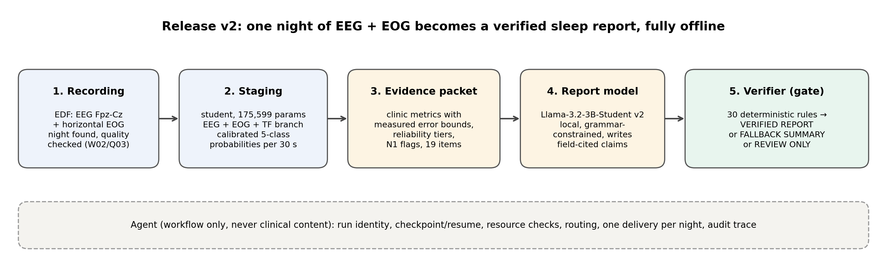

*Fig. 3.1 — System overview: five stages plus the agent.*

### 3.1.1 Objectives of the Proposed Work

**Primary objectives (measurable):**

| # | Objective | Measure | Target |
|---|---|---|---|
| O1 | Leak-free staging evaluation | Subject-disjoint splits, checked in code | No subject in two splits |
| O2 | Compact, accurate student | Params; held-out κ | < 200 K; ≥ teacher's κ |
| O3 | Verified reports | Reports released with a flaw, locked test set | 0 |
| O4 | Report completeness | Nights at 5/5 mandatory items, dev | ≥ 30/31 (pre-registered) |
| O5 | Robust agent | Fault scenarios reaching their expected outcome | All |

**Secondary objectives:** calibrated confidence; measured reliability of each derived metric;
byte-identical reruns; graceful behaviour without the EOG channel; an edge budget within a
Raspberry Pi 5's 16 GB.

## 3.2 Methodology

### 3.2.1 Overview of the Approach

The work proceeded in six stages, each gated by a measured result before the next began:

1. **Knowledge distillation.** Audit the inherited model, rebuild subject-level splits, retrain the
   teacher, diagnose why naive KD failed, then fix the encoder and distil from an ensemble.
2. **Student model.** Add an EOG branch, a time-frequency branch and local epoch context through gates
   that start closed; correct the labels; distil from the ensemble teacher (release v2).
3. **Evidence packet.** Calibrate, decode the hypnogram, measure the error of every derived metric, fit
   the night-confidence tiers and the N1 flag on validation, and assemble the packet.
4. **SLM.** Establish that the 30-rule contract is satisfiable with a large reference model, generate
   training targets, LoRA-tune small models, select on dev, evaluate once on test.
5. **Agentic workflow.** Wrap the frozen pipeline in a deterministic state machine with quality checks,
   fallbacks and crash recovery; evaluate it with fault scenarios and invariants.
6. **Edge simulation.** Budget time and memory analytically for a Raspberry Pi 5, define a simulation
   ladder (container limits, ARM64 emulation, overnight replay, hardware) and pre-register acceptance
   bars.

### 3.2.2 Dataset Selection

**Sleep-EDFx** (PhysioNet): 197 recordings (153 SC + 44 ST) from 100 subjects; 237,950 scored epochs.
Each epoch has 3,000 EEG samples (Fpz-Cz, 100 Hz) and 34 Welch spectral features; release v2 adds the
horizontal EOG. Class shares: N2 37.4%, W 29.5%, REM 14.4%, N1 10.6%, N3 8.2%.

Almost every subject was recorded on two consecutive nights, so a recording-level split puts the same
person in training and test. All splits are made **by subject** (first five characters of the recording
ID), stratified by cohort, and checked in code (Fig. 3.2).

**Table 3.1 — Dataset and split summary.**

| Split | Subjects | Recordings | SC | ST | Role |
|---|---:|---:|---:|---:|---|
| Train | 69 | 137 | 54 | 15 | Model and SLM training (123 + 14 nights for the SLM) |
| Validation (dev) | 16 | 31 | 12 | 4 | Calibration, tier fitting, model selection |
| **Test (locked)** | **15** | **29** | **12** | **3** | One logged evaluation per model |
| 5-fold CV | 85 (non-test) | 168 | — | — | Architecture ablation |
| B1 benchmark | 78 SC | 153 | 153 | — | Standard 10-fold subject-wise protocol |

**Label correction.** The original preprocessing removed unscored epochs from the label sequence
*before* computing trim points, then cut the full signal with those points, so each dropped epoch shifted
every later label by one epoch. Rebuilt from the raw hypnograms, the corrected labels change 5.65% of
training labels, 7.10% of validation and 5.17% of test. **All release v2 numbers use corrected labels.**
v1-era numbers in Section 4.5 use the original *stored* labels and are not comparable with v2's.

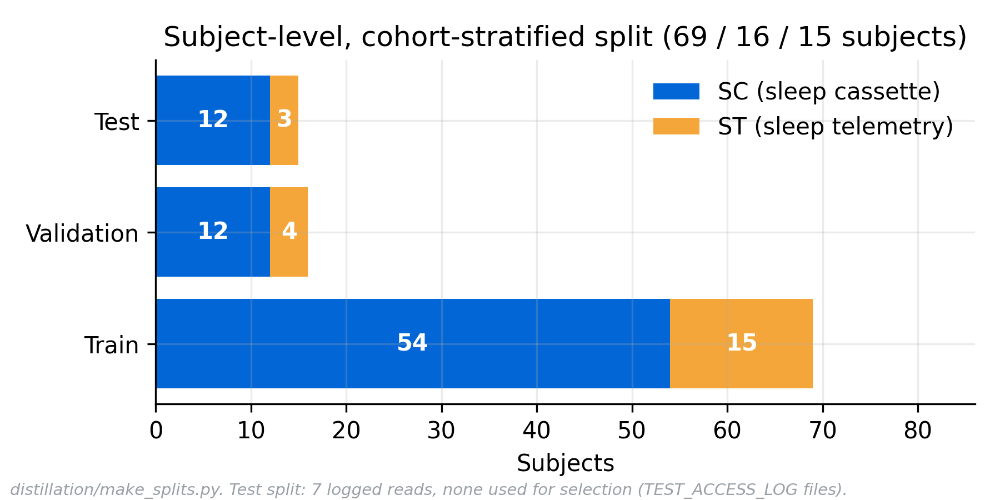

*Fig. 3.2 — Subject-level split. Test reads are logged; none was used for selection.*

### 3.2.3 Algorithm/Model Design

**Teacher.** The ensemble teacher ENSmc averages the softmax of three students of the same family
(121,099 + 139,606 + 151,606 = **412,311** parameters). It replaced a single 649,229-parameter teacher
after the experiments in Section 4.5.

**Student, release v1 (N4kd, 139,606 params, historical).** One EEG channel plus 34 spectral features,
read as sequences of 256 epochs (about 2 h):

```
EEG epoch (3000 samples)
 ├─ fine branch   Conv k50 s6 (24) → MaxPool 8 → Conv k8 (48) → MaxPool 4
 ├─ coarse branch Conv k200 s25 (24) → MaxPool 4 → Conv k6 (48) → MaxPool 2
 └─ adaptive pool → 4 tokens → Linear(96→64) → attention pooling → 64-d epoch vector
34 spectral features → Linear(34→64)
fusion → Linear → LayerNorm → GELU (64)
positional encoding → Transformer encoder (2 layers, d=64, 2 heads, FF 256) → Linear(64→5)
```

The multi-scale encoder's measured receptive field is **8.75 s**, wide enough to contain a spindle,
K-complex or slow wave; the original encoder's was 25 samples (0.25 s) (Fig. 3.3).

**Student, release v2 (N6adv, 175,599 params, current).** The v1 backbone unchanged, plus three parts,
each joining through a **gate that starts closed** (zero-initialised projection, gate bias −4), so at
initialisation the model computes exactly v1's function and moves away only if that helps (Fig. 3.4):

**Table 3.2 — Release v2 staging student.**

| Part | What it does | Params |
|---|---|---:|
| v1 backbone | Unchanged | 139,606 |
| EOG encoder | Saccade branch (Conv k50 s6) + slow-eye-movement branch (Conv k400 s50) + 8 hand-made EOG features → 32-d | 6,768 |
| EOG projection + gate | 32 → 64, sigmoid gate on [h, EOG] | 8,320 |
| Time-frequency encoder | STFT (2 s window, 1 s hop), 0.5–30 Hz at 0.5 Hz bins, 2 convolutions → 32-d | 7,848 |
| TF projection + gate | 32 → 64, sigmoid gate | 8,320 |
| Local context | Depthwise conv k7 over ±3 neighbouring epochs, zero-initialised | 4,672 |
| Auxiliary transition head | Predicts stage changes (training only) | 65 |
| **Total** | | **175,599** |

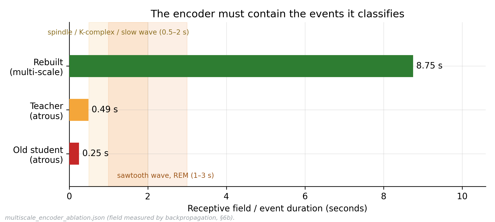

*Fig. 3.3 — Measured receptive field of the original (0.25 s) and multi-scale (8.75 s) encoders.*

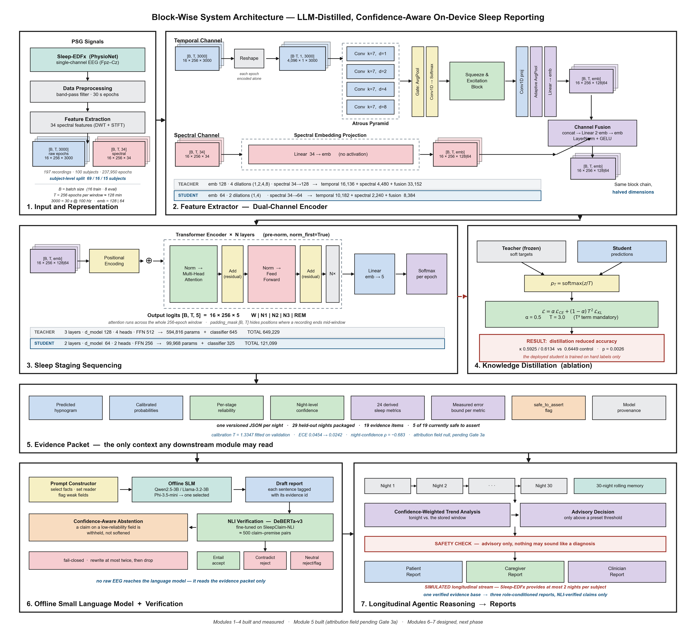

*Fig. 3.4 — Block-wise architecture of the staging student.*

**Evidence packet.** A deterministic builder turns per-epoch probabilities into a versioned JSON packet
(Table 3.3). Fields that are not yet populated are present and `null`, so adding them later does not
break consumers.

**Table 3.3 — Evidence packet schema 1.3 (top level).**

| Field | Content |
|---|---|
| `schema_version` | `"1.3"`; consumers refuse a mismatch |
| `recording_id`, `subject_id`, `cohort` | Identity |
| `provenance` | Model, checkpoint sha256, git commit, calibration temperature, decoder, generator |
| `hypnogram`, `decoding` | Predicted stages, stage runs, how the hypnogram was decoded |
| `probabilities` | Calibrated per-epoch probabilities, 5 classes |
| `per_stage` | Counts, mean confidence, model reliability tier per stage |
| `derived_metrics` | 24 metrics (TST, efficiency, WASO, REM latency, …) |
| `derived_metric_reliability` | Which metrics may be asserted: robust / fragile / unreliable, from measured error |
| `night_confidence` | Tier and mean entropy; no ground truth needed |
| `evidence_items` | 19 items with stable IDs that claims must cite |
| `attribution` | Integrated-Gradients profile (v1 packets); `risk` reserved |

**Report model (SLM).** Llama-3.2-3B-Instruct with LoRA adapters, quantised to Q4_K_M (2.02 GB), run by
`llama-completion` under a GBNF grammar (`report/claims.gbnf`) that only admits the claim schema, at
temperature 0 and seed 0, with a chat template pinned to its training date.

**Verifier.** Two layers. Layer 1 (structure, packet-independent) owns the closed world: valid JSON,
known claim types, fields, evidence IDs and enums, no duplicates. Layer 2 (policy, reads the packet)
checks that every cited value equals the packet's value exactly, that unreliable values are hedged, that
nothing is double-counted, that no unsafe item is cited without a review flag, and that the 5 mandatory
items for the night's tier are covered. 30 violation codes in total.

**Agent.** A state machine whose steps each write to their own directory and return a decision naming
the next step. Run identity is `hash(input, policy, release manifest)`. Finished steps are replayed from
their markers, an interrupted step is wiped and re-run, every transition is traced, and the walk is
bounded so a run always ends.

### 3.2.4 Tools and Technologies

**Table 3.6 — Tools and technologies.**

| Area | Tools |
|---|---|
| Language | Python 3 |
| Signal processing | MNE (EDF reading, resampling), SciPy (Welch PSD), NumPy, pandas |
| Staging models | PyTorch; trained on Kaggle (NVIDIA T4) |
| Report model | Hugging Face Transformers + PEFT (LoRA) on Kaggle T4; llama.cpp b10927 (`llama-quantize`, `llama-completion`) for GGUF Q4_K_M inference on CPU |
| Reference model | Gemini 3.1 Flash, used once offline to establish the contract and generate training targets |
| Constrained decoding | GBNF grammar |
| Agent | Plain-Python state machine, YAML release manifests and policy, sha256 pinning, atomic file writes |
| Interface | FastAPI + Uvicorn console (`python -m ui`), static HTML/JS, no external assets |
| Testing | pytest (agent: 48 tests at Phase 4; distillation: KD-loss, split and provenance tests) |
| Edge (designed) | Raspberry Pi 5 16 GB, Raspberry Pi OS Lite 64-bit, NVMe, systemd, nftables; Docker + QEMU for ARM64 emulation |

**System architecture.** Offline research scripts (`distillation/`, `student/`) produce the staging
checkpoint, fitted tables and the GGUF report model. At runtime the agent (`agentic/`) or the console
(`ui/`) drives: preprocessing → staging adapter → packet builder → report backend → verifier →
renderer → outbox, with release files (`agentic/config/releases/v2.yaml`) pinning every component by hash.

### 3.2.5 Algorithm or Model Description

**Knowledge-distillation loss.** For student logits $z_s$, teacher logits $z_t$, labels $y$, mixing weight
$\alpha$ and temperature $T$:

$$\mathcal{L} = \alpha \cdot \mathrm{CE}(z_s, y) + (1-\alpha)\, T^2 \cdot \mathrm{KL}\big(\mathrm{softmax}(z_t/T)\,\|\,\mathrm{softmax}(z_s/T)\big)$$

with $\alpha = 0.5$, $T = 3.0$. The $T^2$ factor keeps the soft-target gradient on the same scale as the
hard-label gradient; without it training still runs but silently learns worse, so a unit test covers it.
Teacher outputs are cached once rather than recomputed every epoch.

**Algorithm 1 — Ensemble-teacher distillation of the staging student**

```
Input : training recordings R_train (subject-disjoint), K trained students S_1..S_K,
        student architecture A, α, T
Output: distilled student S*
1: for each recording r in R_train do
2:     z_t[r] ← log( (1/K) Σ_k softmax(S_k(r)) )        # ensemble teacher, cached to disk
3: end for
4: initialise S* from A (warm start from the v1 backbone; new gates closed)
5: for epoch = 1..75 do
6:     for each batch of 256-epoch sequences (x, y, r) do
7:         L ← α·CE(S*(x), y) + (1−α)·T²·KL(softmax(z_t[r]/T) ‖ softmax(S*(x)/T))
8:         L ← L + 0.1 · transition-loss          # auxiliary head
9:         update S* with AdamW; update EMA weights
10:    end for
11:    keep S* if validation macro-F1 improves     # validation only, never test
12: end for
```

Training details (v2): warm start from v1 with the backbone frozen for 10 epochs then trained at 0.1×
learning rate; AdamW (lr 3e-4, weight decay 1e-2); boundary-aware label smoothing (ε 0.2); a quality mask
that leaves flat or stuck epochs out of the loss; amplitude augmentation (0.75–1.33×) with the spectral
features moved consistently; EMA (0.999); modality dropout 0.25, so EOG and TF are each switched off for a
quarter of training sequences and the model learns to cope without them; 3 seeds.

**Calibration and confidence.** Temperature scaling fits one scalar $T_c$ on validation by minimising
negative log-likelihood and applies it unchanged to test. Night confidence is the mean prediction entropy
over the night; tier boundaries are validation-entropy tertiles.

**Derived-metric reliability.** For each of the 24 metrics, the error between the value computed from
predicted stages and from expert stages is measured on validation, and the metric is classed robust,
fragile or unreliable. The report may assert only robust values plainly; others must be hedged.

**Algorithm 2 — Verified report generation (one night)**

```
Input : evidence packet P, release manifest M, policy Π
Output: one delivered page
1: assert sha256 of model, grammar, template, verifier, renderer = M.pinned   else REVIEW_ONLY (I01)
2: prompt ← build_prompt(P1, P)
3: wait until device temperature and free RAM satisfy Π                     else FALLBACK (F01)
4: for attempt = 1 .. 1 + Π.retries do
5:     text ← llama-completion(model, prompt, grammar, temp=0, seed=0)
6:     if process ok and end marker seen then break
7: end for
8: if generation failed then return FALLBACK (F02)
9: V ← verify_structure(text) ∪ verify_policy(text, P)
10: if V ≠ ∅ then return FALLBACK (F03)                                   # never rendered
11: page ← render(text, P)                                                 else FALLBACK (F04)
12: if page contains a number without packet provenance then REVIEW_ONLY (V01)
13: deliver page to the outbox exactly once; log the run
```

**Algorithm 3 — Agentic Path B (raw EDF, no expert hypnogram)**

```
ingest      → reject if unreadable (R01) or too short (R03); review if a required channel is missing (W05)
preprocess  → resample to 100 Hz, 30-s epochs, 34 spectral features
stage pass 1 → staging adapter on the whole file
study period → estimate the sleep span from pass-1 stages; review if none (R04)
quality     → flat / stuck / line-noise fraction; review above threshold (Q01, Q03), warn otherwise (W02, W10)
stage pass 2 → stage only the span; warn if the span moved (W08)
build packet → release's own packet builder; reject on schema mismatch (R10)
→ Algorithm 2 → annotate the page with a quality note → V-HTML check → deliver
```

**Table 3.5 — Agent outcomes and reason codes.**

| Outcome | When | Examples |
|---|---|---|
| VERIFIED_REPORT | Every claim passed the verifier and the page passed V-HTML | — |
| FALLBACK_SUMMARY | Report could not be produced safely; page shows packet numbers only | F01 hot / low RAM, F02 crash / timeout, F03 verifier violations, F04 render refused |
| REVIEW_ONLY | Night cannot be summarised safely; nothing shown | R04 no sleep span, Q01/Q03 bad signal, W05 missing channel, I01 changed hashes, V01 untraced number |
| REJECTED | Input fails minimum requirements | R01 unreadable, R03 too short, R10 schema mismatch |

Warnings (W02, W08, W10) still deliver a report but copy the run to the review queue.

**Edge budget model.** Token generation for a quantised model on a CPU is limited by memory bandwidth:
each generated token reads all weights once, so tokens/s ≈ effective bandwidth / bytes read per token.
For Llama-3.2-3B Q4_K_M this gives a ceiling of 7.43 tokens/s at the Pi 5's theoretical 17 GB/s, and
3.06–4.37 tokens/s at an assumed effective 7–10 GB/s.

### 3.2.6 Expected Outcomes

- A staging student under 200 K parameters at or above its teacher's κ on unseen subjects, and
  competitive on the standard benchmark.
- An evidence packet whose confidence signals separate good nights from bad without ground truth.
- A report model that, behind the verifier, releases no flawed report on held-out nights.
- An agent that reaches the expected outcome in every fault scenario and reproduces its outputs exactly.
- A credible, measurable plan for overnight operation on a Raspberry Pi 5.

### 3.2.7 Advantages of the Proposed Work

- **Small.** The staging model is 0.70 MB (fp32), smaller than every published model above it on the
  benchmark except LightSleepX.
- **Safe by construction.** The verifier compares values exactly, so a released report cannot contain a
  number that differs from the packet; a failure produces a fallback, not a wrong report.
- **Honest about uncertainty.** Each derived value carries its measured reliability; only 3 of 24 metrics
  are safe to state without qualification, and the report says so.
- **Private.** Everything runs offline; the edge design drops all outbound traffic.
- **Reproducible and auditable.** Every component is hash-pinned, runs are deterministic, and every run
  is traced.
- **Robust.** Missing EOG costs only 0.012 κ; bad signals, crashes, overheating and power loss each end in
  a defined, truthful outcome.
- **Swappable.** A new staging or report model is a new release file, not new agent code.

### 3.2.8 Limitations and Assumptions

- **One dataset.** Everything rests on Sleep-EDFx. Within it, crossing from the SC to the ST cohort cost
  0.187 κ for a v1-era model, which shows how little a single-dataset figure should be trusted to transfer.
- **Small evaluation sets.** 29 test nights give a 95% lower bound of 82.2% on 28/29; the test set has
  been read 7 times across the model line (logged, never for selection) and cannot evaluate any later model.
- **"Verified" means consistent with the packet**, not clinically correct. No clinician has rated a report.
- **Label differences.** Corrected labels may differ from other papers' pipelines.
- **Path B uses the dataset's lights-off times** for the device-like crop; the study-period end-point
  p90 error is 49 epochs against a 30-epoch bar (an accepted deviation).
- **Edge numbers are estimates.** Docker, ARM64 and Raspberry Pi measurements have not been run.
- **The full system is not small.** The report model is 99.9% of the footprint (2.02 GB on disk, about
  4.7 GB peak RAM).

---

# Chapter 4 — Experimentation and Result Analysis

This chapter reports the experiments in the order the work was done. Every number comes from a results
file in the repository (Appendix A).

## 4.1 Experimental Setup

- **Training:** Kaggle notebooks, NVIDIA T4 GPU (16 GiB). Each staging run took about 20 minutes; the
  report model's LoRA training took 169 minutes (v2).
- **Inference and evaluation:** a Windows x86 PC (CPU only) with about 7 GB free RAM; llama.cpp b10927;
  Python 3 with PyTorch, MNE and SciPy.
- **Determinism:** report generation at temperature 0, seed 0, fixed grammar and pinned chat template.
- **Edge target (not yet measured):** Raspberry Pi 5, 4× Cortex-A76 at 2.4 GHz, 16 GB LPDDR4X, NVMe.

## 4.2 Datasets

Sleep-EDFx as described in Section 3.2.2. Additional evaluation configurations:

- **Standard benchmark (B1):** Sleep-EDF-78 (SC only, 78 subjects, 153 nights), 10-fold subject-wise
  cross-validation, trained from scratch (no warm start, no distillation). 78/78 subjects and 153/153
  recordings each appear in exactly one fold.
- **Cohort transfer:** train on 62 SC subjects, test on all 22 ST subjects.
- **Path B (raw EDF):** the 31 dev nights cropped at lights-off to a 12-hour device-like window, with no
  expert hypnogram; the study period is estimated by the model.
- **Report model:** 123 training nights and 14 validation nights with reference targets; 31 dev nights
  for selection; the 29 test nights once.

## 4.3 Evaluation Metrics

- **Staging:** accuracy; **Cohen's κ** (primary, robust to class imbalance); macro-F1 and per-class F1;
  bootstrap 95% CIs resampled **by subject**; paired Wilcoxon signed-rank tests per subject.
- **Calibration:** expected calibration error (ECE, 15 bins); night-level Pearson / Spearman correlation
  between mean entropy and κ.
- **Reports:** verified (no violation); **5/5** (verified and all mandatory items covered); violations;
  **numeric fidelity** (cited values equal to packet values); flawed reports released; two-sided 95%
  Clopper–Pearson lower bound (for n/n successes, $0.025^{1/n}$).
- **Agent:** outcome and reason codes per scenario; invariants I1–I8; byte-identical reruns; wall time.
- **Edge:** tokens/s, seconds per night, peak memory (analytical now; measured in Phase II).

## 4.4 Experimental Design

**Baselines:** the inherited 649,229-parameter model (re-evaluated honestly); retrained teachers E0, E1a,
E1b; a non-distilled student of the same size (the control for every KD experiment); the v1 student
N4kd; YASA 0.8.1; the published models of Table 2.1; and, for reports, five untrained small models and
the untrained Llama-3.2-3B.

### 4.4.1 Experimental Scenarios

1. **Exposure gradient:** the inherited model on epochs it trained on, on the same subject's other
   night, and on an unseen subject.
2. **KD vs control:** students distilled from teachers of different quality against an identical student
   trained on hard labels only.
3. **Encoder and channel ablations:** receptive field, raw EEG zeroed, EOG added.
4. **Architecture ablation (5-fold CV, same labels):** `base` → `full_eeg` (TF + local context + recipe)
   → `full` (+ EOG).
5. **Missing channel:** v2 evaluated with the EOG input removed.
6. **Report-model selection:** reference run, grammar ablation, LoRA students on dev, one test run.
7. **Verifier ablation:** gate on / gate off / gate and grammar off, on 31 dev nights.
8. **Agent fault scenarios:** 15 scenarios on real EDF files and injected report-model faults.
9. **Sampling rates and line noise:** 128 and 256 Hz recordings; 49/50 Hz noise injected at 0.25–2× EEG RMS.
10. **Reproducibility:** Path B twice per dev night in fresh runtime directories with the real model.

### 4.4.2 Parameter Tuning

- Distillation: α = 0.5, T = 3.0, fixed for every reported run (a sweep is deferred, see Chapter 5).
- Staging: AdamW, lr 3e-4, 75 epochs, early stopping on **validation** macro-F1; 3 seeds for v2.
- Calibration temperature, decoder, night-confidence tiers and the N1 flag threshold: fitted on
  validation only, applied unchanged to test.
- Report model: hyperparameters pre-registered and locked before training (Table 3.4); a pre-registered
  5-epoch fallback for Qwen was tried and declined.
- Agent thresholds (quality, study period, resources): set in `policy.yaml` and calibrated on train/dev.

**Table 3.4 — Report-model training configuration (identical for v1 and v2).**

| Parameter | Value |
|---|---|
| Base models | Llama-3.2-3B-Instruct; Qwen2.5-1.5B-Instruct |
| Method | LoRA (PEFT), rank 16, α 32, dropout 0.05, on q/k/v/o and MLP projections |
| Optimiser | lr 2e-4, cosine; effective batch 8; 3 epochs; seed 0 |
| Data | 123 training nights, 14 validation nights; targets = reference claim sets that pass the verifier, serialised in the grammar's field order |
| Max sequence | 3,072 tokens |
| Export | F16 → Q4_K_M with llama.cpp b10927 |

## 4.5 Results

### 4.5.1 Stage 1 — Knowledge Distillation (v1, stored labels, historical)

**The inherited model had memorised people (Fig. 4.1).**

| Exposure level | κ | Macro-F1 | N3 F1 | REM F1 |
|---|---:|---:|---:|---:|
| Same recording (trained on) | 0.8058 | 0.8036 | 0.889 | 0.876 |
| Same subject, other night (leaked) | 0.6797 | 0.7173 | 0.837 | 0.718 |
| **Unseen subject** | **0.5066** | **0.4107** | **0.000** | **0.184** |

The reported κ 0.6663 is reproduced to within 0.0008 as a blend of the leaked and clean measurements,
confirming leakage as the explanation.

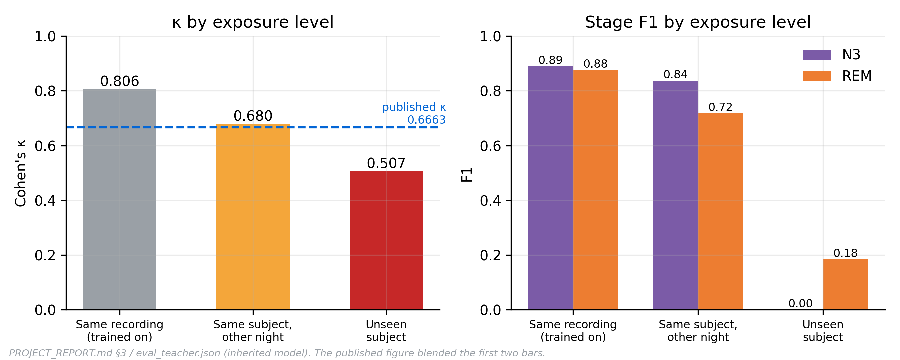

*Fig. 4.1 — Exposure gradient.*

**Table 4.1 — Distillation experiments, held-out test (15 subjects), stored labels.**

| Model | Params | κ | Macro-F1 |
|---|---:|---:|---:|
| E0 teacher (faithful retrain) | 649,229 | 0.5122 | 0.6063 |
| E1b teacher (double class-weighting fixed) | 649,229 | 0.6055 | 0.6548 |
| Student distilled from E0 | 121,099 | 0.5925 | 0.6611 |
| Student distilled from E1b | 121,099 | 0.6134 | 0.6708 |
| **Student, no distillation (control)** | 121,099 | **0.6449** | **0.6915** |
| Student, multi-scale encoder | 139,606 | 0.6992 | 0.7407 |
| Ensemble teacher (3 students) | 412,311 | 0.7140 | 0.7542 |
| Student distilled from the ensemble (v1, N4kd) | 139,606 | 0.7001 | 0.7376 |

**Findings.**

1. **Fixing the teacher's loss mattered more than capacity.** E1a's focal loss applied class weights
   twice, suppressing N2; fixing it (E1b) raised test κ from 0.559 to 0.606 with no added parameters
   (Fig. 4.2).
2. **Naive KD hurt.** Both distilled students scored below the control, significantly. The student had
   outgrown its teacher during training, so half of every gradient pulled a good model towards a worse
   one (Figs. 4.3, 4.4). **A teacher must exceed the student's own undistilled performance before its
   soft targets carry usable information.** No choice of α or T can fix this.
3. **The encoder could not see sleep.** Its receptive field was 0.25 s, too short for any sleep
   microstructure. Widening it to 8.75 s moved the raw EEG from contributing nothing to driving 71% of
   predictions and raised N1 F1 by 0.092.
4. **An ensemble of comparable, diverse students is a teacher that works.** It exceeds each member, and
   distilling it removed the penalty. On accuracy the distilled student tied its hard-label twin; what
   improved was **calibration**: ECE fell by about a third and REM-latency error nearly halved (Fig. 4.5).
5. **The evaluation became the limit.** 5-fold subject-level CV showed the original validation split was
   an unrepresentative draw (κ 0.7143 across folds vs 0.6763 on that split; fold SD 0.0193), larger than
   the whole distillation effect on κ (0.0008).

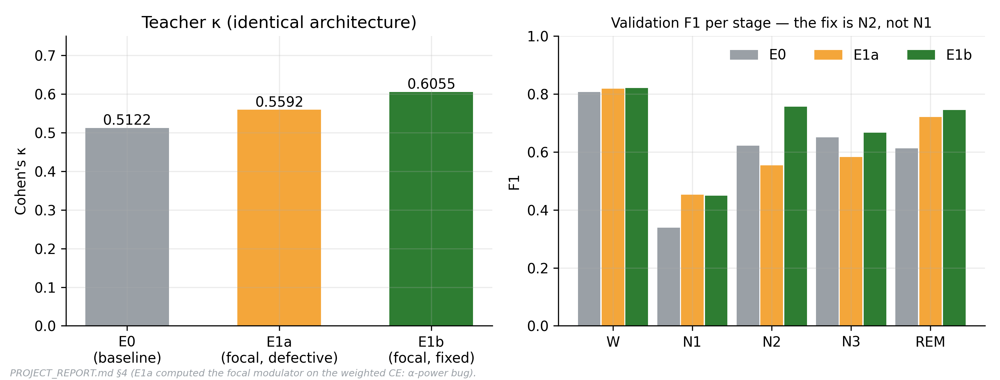

*Fig. 4.2 — Teacher ladder.*

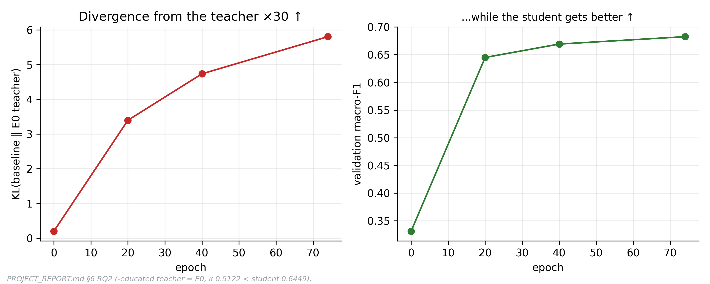

*Fig. 4.3 — Why single-teacher KD failed.*

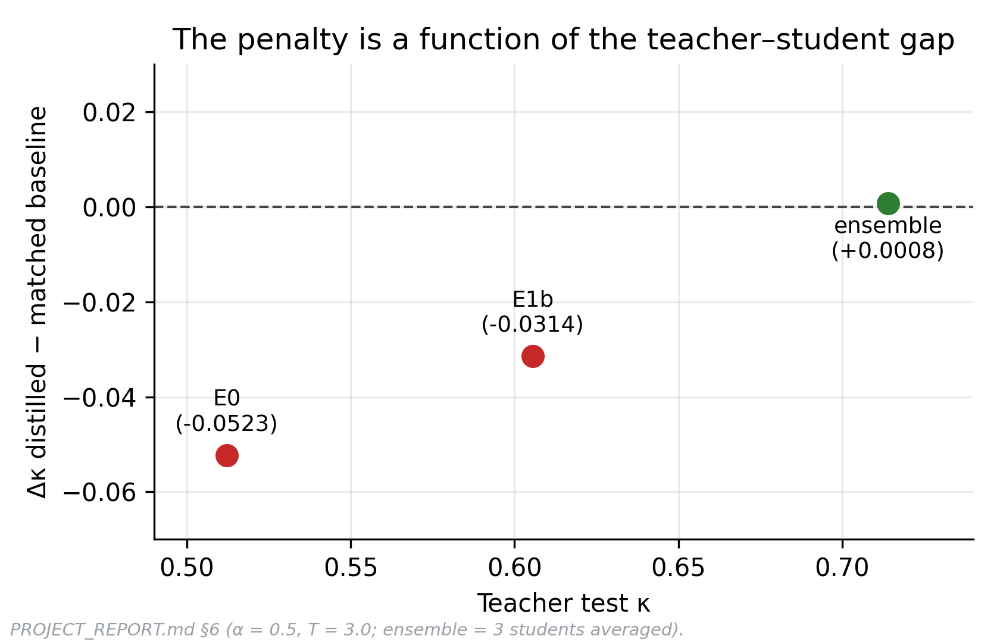

*Fig. 4.4 — KD penalty against teacher quality.*

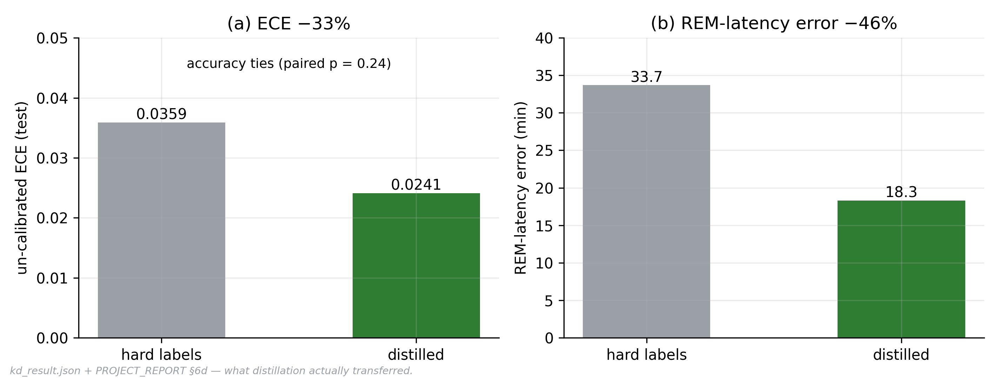

*Fig. 4.5 — Calibration transfer through distillation.*

### 4.5.2 Stage 2 — Student Model (release v2, corrected labels)

**Table 4.2 — Held-out test, 15 subjects, 29 nights, 33,365 epochs, corrected labels.**

| Model | Params | Input | Accuracy | κ | Macro-F1 | N1 F1 | REM F1 |
|---|---:|---|---:|---:|---:|---:|---:|
| ENSmc teacher | 412,311 | EEG | 80.02% | 0.732 | 76.91 | 48.7 | 81.8 |
| v1 student (N4kd) | 139,606 | EEG | 79.00% | 0.718 | 75.23 | 45.5 | 78.2 |
| **v2 student (N6adv)** | **175,599** | **EEG + EOG** | **81.96%** | **0.756** | **78.20** | **50.7** | **83.7** |
| v2, EOG removed | 175,599 | EEG | 81.10% | 0.744 | 77.20 | 48.7 | — |

- v2 vs v1: Δκ +0.038, 95% CI [+0.019, +0.057]; better on 13/15 subjects (Wilcoxon p = 0.0009); every
  stage improves (W +0.7, N1 +5.3, N2 +2.4, N3 +1.0, REM +5.3 F1 points). Accuracy passes 80% on both
  cohorts (SC 82.1%, ST 81.4%).
- v2 beats its teacher on every metric with 43% of its parameters. *This test comparison combines label
  correction, EOG and the training recipe;* the like-for-like attribution is the ablation below.

**Table 4.3 — Architecture ablation, 5-fold CV, corrected labels for every arm (Fig. 4.7).**

| Arm | Params | κ | Δκ vs base, 95% CI |
|---|---:|---:|---|
| `base` (v1 architecture) | 139,606 | 0.7584 | — |
| `full_eeg` (+ TF branch, local context, recipe) | 160,511 | 0.7653 | +0.0069 [+0.003, +0.011] |
| **`full` (+ EOG) = v2** | **175,599** | **0.7763** | **+0.0179 [+0.0095, +0.026]**, better on 5/5 folds |

**Table 4.4 — Standard benchmark B1 (Sleep-EDF-78, 10-fold subject-wise, from scratch).**

| Aggregation | Accuracy | κ | Macro-F1 | W | N1 | N2 | N3 | REM |
|---|---:|---:|---:|---:|---:|---:|---:|---:|
| Final epoch, mean of folds (conservative) | 83.0% | **0.769** | 78.4 | 92.7 | 51.6 | 84.3 | 77.8 | 85.7 |
| Selected epoch (optimistic) | 83.5% | 0.775 ± 0.018 | 79.0 | 92.9 | 53.1 | 84.7 | 78.3 | 85.9 |
| Per-recording mean | 83.2% | 0.761 | 73.7 | — | 52.5 | — | — | — |

The project's own 5-fold CV (83.5%, κ 0.776) and B1 (83.5%, κ 0.775) used different folds, subjects and
training starts and agree within 0.001 κ.

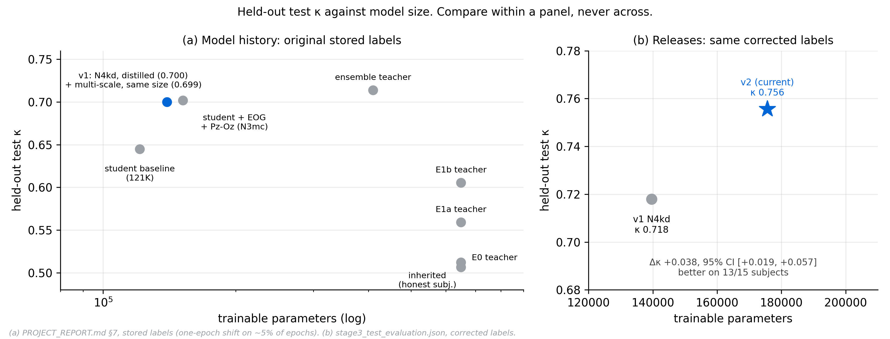

*Fig. 4.6 — Model size against κ; v1 vs v2 on the same corrected labels.*

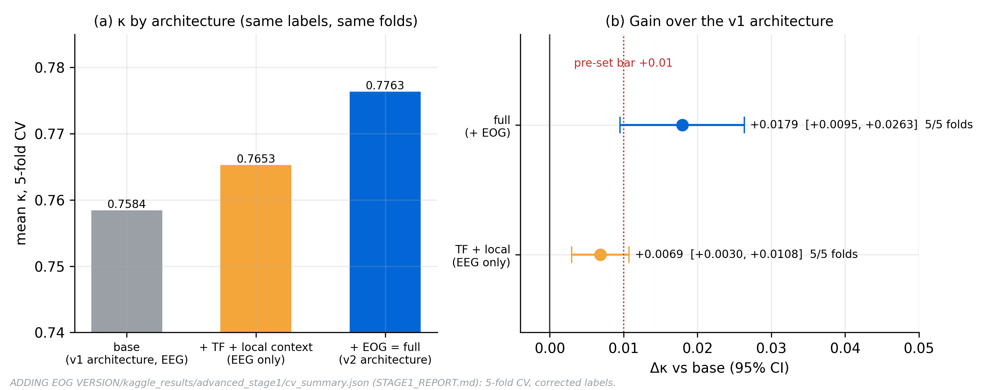

*Fig. 4.7 — Architecture ablation.*

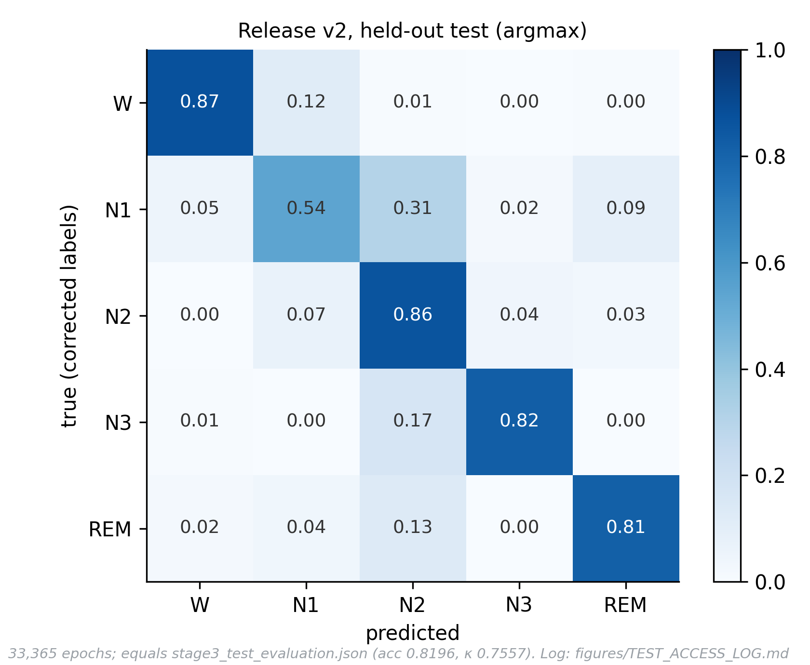

*Fig. 4.8 — Confusion matrix, release v2, held-out test.*

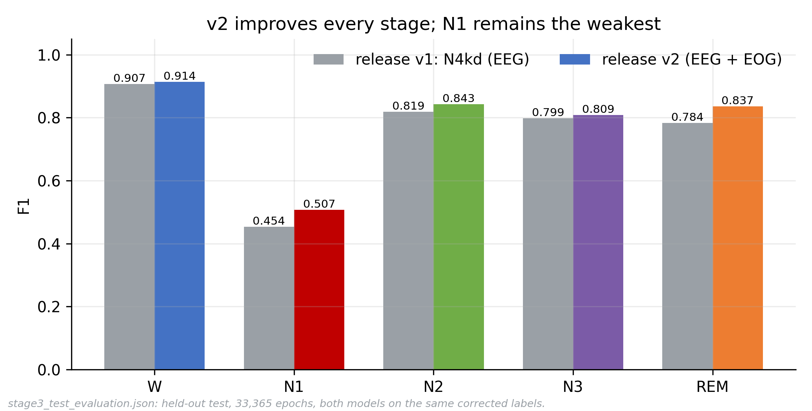

*Fig. 4.9 — Per-class F1, v2 vs v1.*

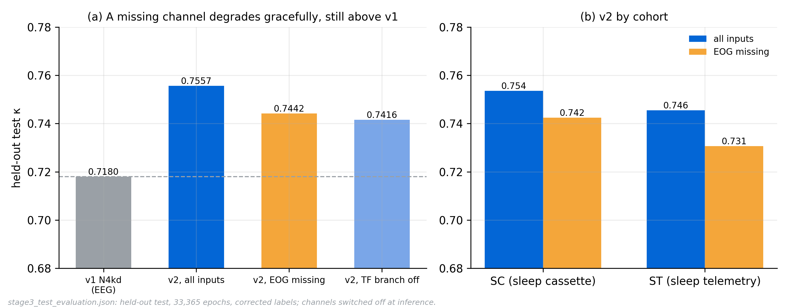

*Fig. 4.10 — Robustness to a missing EOG channel.*

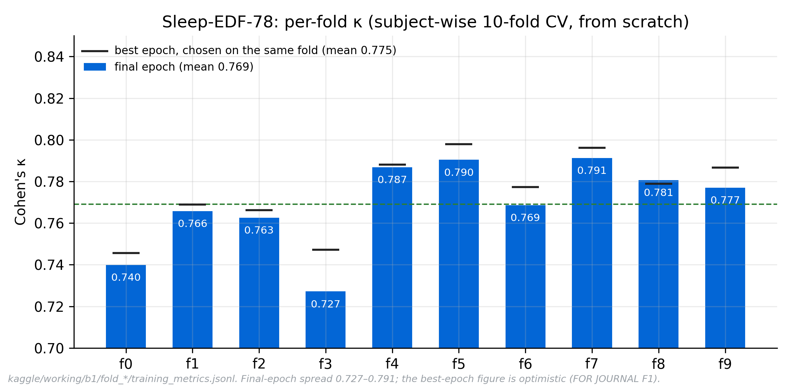

*Fig. 4.11 — B1 per-fold κ (bars: final epoch; markers: selected epoch).*

### 4.5.3 Stage 3 — Evidence Packet (release v2)

**Table 4.5 — Calibration and confidence signals (v2).**

| Signal | Result |
|---|---|
| Calibration temperature (fitted on validation) | 1.0021 — the v2 model is already calibrated (EMA, label smoothing) |
| ECE, test | 0.0133 before, 0.0134 after; validation 0.0119 → 0.0120 |
| Per-stage reliability (test F1) | W 0.914 high · N2 0.844 high · REM 0.837 high · N3 0.809 high · **N1 0.507 low** |
| Night confidence vs expert agreement | Test Pearson r = −0.637 (p = 2.0 × 10⁻⁴), Spearman ρ = −0.614; validation r = −0.543 |
| Independent of stage composition | Partial r = −0.623 controlling for N1 and REM fraction; composition explains 6–13% of the variance |
| Tiers (validation-fitted), test mean κ | High 0.788 (15 nights) > medium 0.731 (4) > low 0.689 (10); monotone without being fitted on test |
| Triage | Flagging the 10 lowest-confidence nights catches 5 of the 10 worst (mean κ 0.689 vs 0.776) |
| Derived-metric reliability | 3 robust, 13 fragile, 8 unreliable of 24 (Fig. 4.13) |
| N1 confidence flag | Threshold 0.475 fitted on validation; not measured on test for v2 (v1's flag held as a ranking, +10.9 points separation, but missed its level target) |

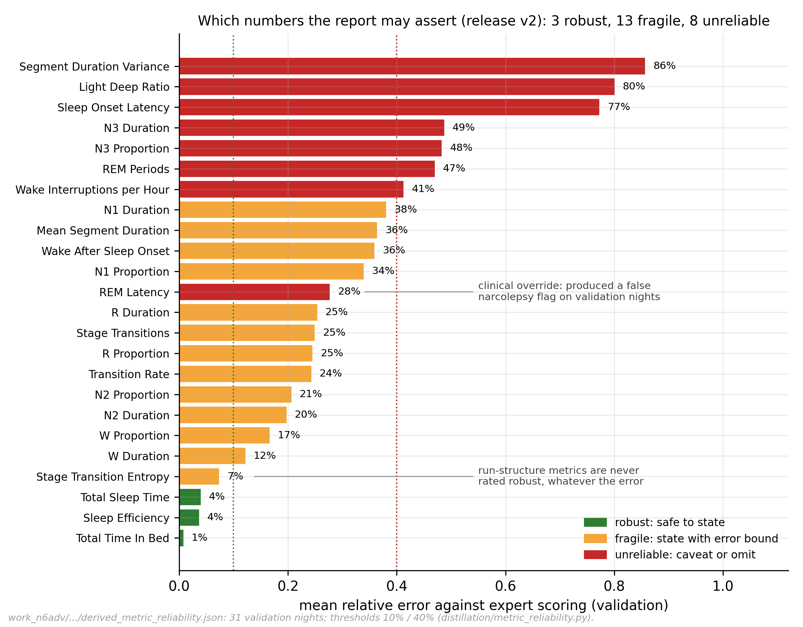

*Fig. 4.13 — Derived-metric reliability: which numbers a report may state.*

### 4.5.4 Stage 4 — Small Language Model

**Is the contract achievable?** A large reference model (Gemini 3.1 Flash, temperature 0, structured
output + grammar, prompt P1) produced 30/30 reports at 5/5 with 0 violations and numeric fidelity 1.000 on
dev. Its verifier-passing outputs on the 123 training nights became the training targets.

**Do untrained small models need training?** With the grammar, the five candidates (Qwen2.5-1.5B,
SmolLM2-1.7B, Gemma-2-2B, Llama-3.2-3B, Phi-3.5-mini) reached 0, 0, 0, 2 and 0 of 31 at 5/5; without it,
0/31 each. The grammar secures syntax, not meaning; no base model has learned the contract.

**Table 4.6 — Report-model selection (pre-registered bar: ≥ 25/31 at 5/5 on dev).**

| Model | Dev 5/5 | Dev violations | Test 5/5 | Test violations | Notes |
|---|---:|---:|---:|---:|---|
| Llama-3.2-3B base | 2/31 | — | — | — | Untrained |
| Qwen-Student 1.5B | 10/31 | 0 | 12/29 | 0 | Misses ~1 of 5 items on medium/high-tier nights; capacity limit |
| Llama-Student v1 (v1 packets) | 30/31 | 3 | **29/29** | 0 | Fidelity 1.000; 406/406 hedged claims; peak RAM 4,719 MiB |
| **Llama-Student v2 (v2 packets, current)** | **31/31** | **0** | **28/29** | 2 (blocked) | Dev fidelity 527/527; test 492/493; **0 flawed released** |

v1 and v2 were scored on different packets and are reported side by side, never pooled (Fisher's exact
p = 1.0 for the one-night difference). 95% lower bounds: v1 test ≥ 88.1%, v2 dev ≥ 88.8%, **v2 test ≥ 82.2%**.

**The one blocked night (SC4611E0).** REM is 0.12% of that night, so the packet's sustained-REM latency
is `None`. The model wrote −1.0 instead of omitting the claim. The verifier flagged
`L2.value_mismatch` and `L2.uncited_quantity`, the text was never rendered, and the agent delivered the
fallback summary — the system working as designed.

**Table 4.7 — Verifier ablation (31 dev nights; definitions pre-registered).** Count of reports released
with a flaw.

| Report model | Gate on | Gate off | Gate and grammar off |
|---|---:|---:|---:|
| **Llama-Student v2** (v2 packets) | **0/31** | **0/31** | **0/31** |
| Llama-Student v1 (v1 packets) | 0/31 | 1/31 | 2/31 |
| Llama-3.2-3B base (v1 packets) | **0/31** (all fall back) | 31/31 | 31/31 |

With the grammar removed, v2's output was byte-identical to its constrained output on all 31 nights: at
temperature 0 the grammar never changed a token. For the fine-tuned model the verifier is a safety net
(it blocked 1 of 29 on test); for an untrained model it is decisive.

**Determinism.** Llama's chat template wrote today's date into the prompt, so outputs changed from day to
day; pinning the template to the training date (release v1.1) fixed it. `llama-server` did not reproduce
the evaluated outputs (20–23/31 vs 30/31), so the system uses one-shot `llama-completion`.

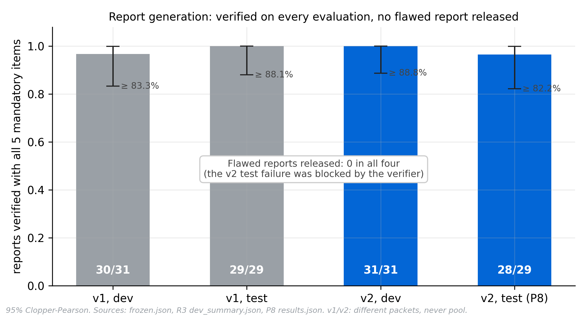

*Fig. 4.14 — Report verification across releases and splits, with 95% Clopper–Pearson bars.*

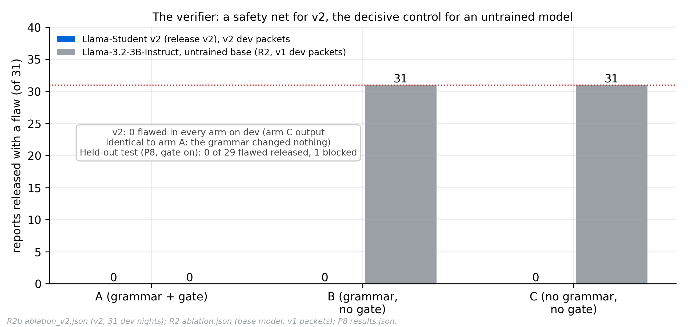

*Fig. 4.15 — Verifier ablation.*

### 4.5.5 Stage 5 — Agentic Workflow

**Table 4.8 — Fault scenarios (real EDF files from a dev night; injected report-model faults).**

| # | Scenario | Expected → obtained |
|---|---|---|
| S01 | Clean night, no hypnogram | VERIFIED_REPORT ✓ |
| S02 | Prebuilt packet (Path A) | VERIFIED_REPORT ✓ |
| S03 | EEG flat for 2 h | REVIEW_ONLY Q01 ✓ |
| S04 | EOG missing | VERIFIED_REPORT ✓ |
| S05 | Fpz-Cz missing, Pz-Oz present | REVIEW_ONLY W05 ✓ |
| S06 | Recorded at 128 Hz | VERIFIED_REPORT (resampled) ✓ |
| S07 | Only 2 h recorded | REJECTED R03 ✓ |
| S08 | Corrupt header | REJECTED R01 ✓ |
| S09 | Report model crashes once | VERIFIED_REPORT after retry ✓ |
| S10 | Report model hangs | FALLBACK F02 ✓ |
| S11 | Report model writes invalid claims | FALLBACK F03 ✓ |
| S12 | Device at 82 °C | FALLBACK F01 after 12 waits ✓ |
| S13 | Power cut during generation | VERIFIED_REPORT, exactly one delivery ✓ |
| S14 | Strong 49 Hz line noise | VERIFIED_REPORT at the time; led to the V5 line-noise check |
| S15 | Two nights of one subject (trend note) | Deferred: needs the history store (Phase II) |

**14/14 pass, 1 deferred.** Invariants hold on every run: I1 no unverified text, I2 every number has
provenance, I3 frozen components, I4 no network, I5 expert hypnograms never read by the workflow, I6 every
run ends, I7 every step traced, I8 every failure visible in the review queue. Crash recovery at eight
boundaries produced exactly one delivery each time.

**Further robustness results.**

| Check | Result |
|---|---|
| Real recordings end to end (Path B, v2, 31 dev nights) | Mean per-night κ 0.701 (v1 0.673; v2 higher on 27/31); pooled accuracy 79.5%, κ 0.719; **30 verified + 1 sent to review (line noise)**, 0 fallbacks, 0 rejected; median 78 s per report on x86 |
| Night boundaries without an expert | Start: median 0, p90 2 epochs; end: median 2, p90 41 epochs (bar 30; accepted deviation) |
| Sampling rates (3 nights × 2 releases × 128/256 Hz) | 18/18 outcomes match 100 Hz; hypnogram agreement 0.992–1.000 |
| Line noise | A 49 Hz tone at 1× EEG RMS drops κ 0.775 → 0.340, and the verifier cannot see it (it checks claims against the packet, not the packet against the signal), so an input check (Q03/W10) was added |
| Quality flags predict worse staging | Dev nights flagged W02: Δκ −0.138, 95% CI [−0.202, −0.072] |
| Reproducibility (real model, 2 runs × 31 nights) | 31/31 byte-identical report pages |
| Preprocessing parity with training | 31/31 exact (EEG, 34 features, probabilities) |

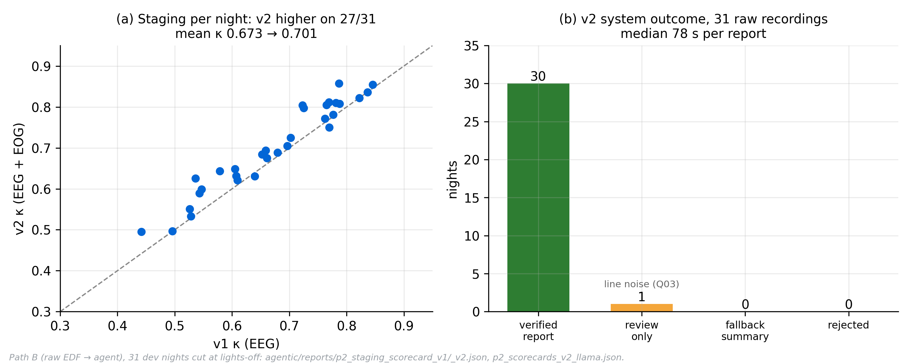

*Fig. 4.16 — Real recordings end to end (Path B).*

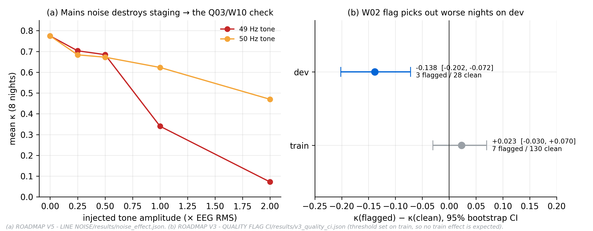

*Fig. 4.17 — Signal-quality checks and line noise.*

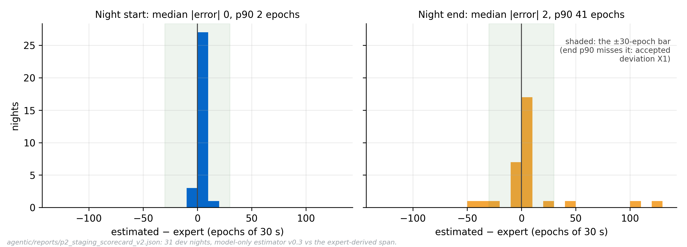

*Fig. 4.18 — Night boundaries found without an expert.*

### 4.5.6 Stage 6 — Edge-Device Simulation (Raspberry Pi 5, 16 GB)

The simulation ladder and its status:

| Level | Question | Status |
|---|---|---|
| L0 Analytical | Bandwidth-bound generation speed and memory | **Done** (Table 4.9) |
| L1 x86 container, 4 CPUs / 16 GB / no network | Does it fit? | Dockerfile and ARM64 requirements written; not built (Docker not installed) |
| L2 ARM64 emulation (QEMU) | Same answers on aarch64? | Not run |
| L3 Overnight replay with faults | Right decisions over a night? | Fault scenarios done on bare x86 (Table 4.8); replay scheduler not built |
| L5 Real Pi 5 | Speed, memory, heat, power | Needs hardware |

**Table 4.9 — Per-night budget on the Pi 5 (analytical estimates, not measurements).**

| Step | Estimate |
|---|---:|
| Ingest + quality checks | 5–20 s |
| Study period (two-pass staging) | 5–15 s |
| Preprocess (resample, epochs, 34 features) | 10–40 s |
| Staging (175 K params, CPU) | 2–10 s |
| Packet | < 5 s |
| Report prefill (~1,100 tokens at an assumed 15–30 tokens/s) | 40–80 s |
| Report generation (~1,200 tokens at 3.06–4.37 tokens/s; ceiling 7.43) | 266–380 s |
| Verifier + render | < 2 s |
| **Total per night** | **≈ 6–9 min** (x86 measured: median 78 s per report) |
| **Peak memory** | **≈ 6–8 GB** of 16 GB (report model ~4.7 GB measured on x86 at a 12,288-token context) |

Memory bandwidth, not memory size, sets speed: the 16 GB board is not faster than the 8 GB one, but it
keeps every model resident with the full context. **Pre-registered acceptance bars for the Pi:** staging
parity max |Δp| ≤ 1e-4 with identical hypnograms; dev 5/5 not below the x86 result, with every failure
caught by the verifier; P95 ≤ 15 min per night; peak ≤ 10 GB; no thermal throttling with the Active Cooler
at 25 °C; all fault scenarios and a 7-night unattended soak with 0 crashes.

## 4.6 Analysis of Results

- **Measurement before modelling.** The largest single change in the project came from evaluation, not
  architecture: subject leakage inflated κ by about 0.16, and misaligned labels cost about 3 accuracy
  points. Every later result depends on fixing both.
- **Distillation works only with a better teacher.** The negative KD result has a mechanism, and the fix
  (an ensemble of comparable, diverse students) followed from it. Distillation's lasting benefit was
  calibration, which the packet then turns into usable confidence.
- **EOG helps where expected.** Like for like, EOG adds +0.018 κ, with the gains on N1 and REM, the stages
  defined partly by eye movements; without EOG the model still beats v1.
- **Trust signals are real.** Night confidence ranks nights by agreement with the expert on test without
  being fitted there, and is not a proxy for stage composition.
- **Training, not the grammar, made the report model correct.** The grammar fixes syntax; fine-tuning
  supplied the semantics; the verifier is the safety net that caught the one remaining error on test.
- **The agent turns failure into a truthful outcome.** Every fault produced a defined page; no scenario
  produced a wrong report.

## 4.7 Observations

- **N1 remains the weak stage** (F1 0.51 on test). Expert agreement on N1 is itself only 25–45%, so the
  packet marks N1 low-reliability rather than claiming more.
- **Rare-stage nights stress the report model.** The one test failure was a night with almost no REM,
  where the correct behaviour was to omit a claim.
- **The verifier checks claims against the packet, not the packet against the signal.** Line noise
  produced a confident, wrong packet that the verifier could not see; only input quality control
  protects against that.
- **Small sets limit resolution.** With 15 test subjects the CI on κ is about ±0.05; several later
  changes returned statistical ties because the evaluation could not resolve them.
- **Statistical significance.** v2 vs v1 staging: Wilcoxon p = 0.0009, Δκ CI excludes 0; EOG ablation CI
  excludes 0 on 5/5 folds; quality-flag effect CI excludes 0 on dev; night-confidence correlation
  p = 2.0 × 10⁻⁴ on test.

## 4.8 Comparative Analysis

**Table 4.10 — Comparative analysis.**

| Comparison | Result |
|---|---|
| Staging vs published (B1, Table 2.1) | κ 0.769–0.775, level with TinySleepNet, LightSleepX and LMCSleepNet (0.77), below SleepSatelightFTC (0.787) and MultiChannelSleepNet (0.79); macro-F1 78.4–79.0 above TinySleepNet and LMCSleepNet; **175,599 parameters, 5–74× smaller** than the models at our level except LightSleepX |
| Per-class (B1) | Strongest on N1 (53.1) and REM (85.9); weaker on N2 (~2 points below best) and N3 (~3.5 points below) |
| Fair EEG-only comparison | `full_eeg` CV κ 0.765; test with EOG removed 0.744 |
| Same nights vs YASA 0.8.1 (31 dev nights) | Accuracy 0.790 vs 0.744; κ 0.701 vs 0.635; macro-F1 0.717 vs 0.642; N1 F1 0.545 vs 0.302; better on 21/31 nights. In-domain advantage disclosed |
| vs our teacher | v2 beats ENSmc on every metric with 43% of its parameters (combined effect of labels, EOG and recipe) |
| vs untrained SLM | Base Llama-3.2-3B: 2/31 at 5/5 and 31/31 flawed without the gate; v2 student: 31/31 dev, 28/29 test, 0 flawed released |
| vs LLM reporting systems (Table 2.2) | Others check output after generation by humans or LLMs; ours blocks a report **before release** with a deterministic check, runs offline at temperature 0, and reruns byte-identically |
| Size | Staging model 0.70 MB; the report model (2.02 GB) is 99.9% of the system footprint |

**Table 4.11 — Head-to-head scorecard against the best existing work.** "Ours" figures are measured in
this repository (release v2 unless stated). Verdicts are qualified where protocols differ.

| Aspect | Best existing (who, figure) | Ours | Verdict |
|---|---|---|---|
| Automatic check of generated text | Human review or LLM-as-judge, after generation | Deterministic verifier before release; 0 flawed reports released on test (28/29 verified, 1 blocked) | **Ahead** |
| Complete report from a local model | Local LLMs on OSA: "needs significant improvement" (different task) | 31/31 dev and 28/29 test at 5/5; base model 2/31 | **Ahead** (different task) |
| Effect of the gate | — (no published ablation) | Untrained model: 31/31 flawed without the gate, 0/31 with it | **Ahead** |
| Uncertainty in the report | Reported (SleepTransformer, YASA), not enforced in text | Hedging enforced by the verifier from measured error | **Ahead** |
| Offline and private | Local-LLM study (Seifen et al.) | Fully offline on CPU; outbound traffic dropped in the edge design | **Ahead** |
| Reproducibility | Not reported | 31/31 byte-identical reruns | **Ahead** |
| Student vs teacher | KD students usually approach the teacher | κ 0.756 vs 0.732 on held-out test (label/EOG/recipe confound disclosed) | **Ahead** (qualified) |
| Size for the accuracy | LightSleepX: 49 K, κ 0.77 (EDF-78) | 176 K, κ 0.769–0.775 (B1, EDF-78) | **Level** |
| N1 F1 | SalientSleepNet 54.2 | 51.6–53.1 (B1) | **Level** |
| REM F1 | SalientSleepNet 85.8 | 85.7–85.9 (B1) | **Level** |
| Overall staging | MultiChannelSleepNet: 85.0%, κ 0.79, 13 M | 83.0–83.5%, κ 0.769–0.775, 0.176 M (B1) | **Behind** by ~1.5 points, 74× smaller |
| N3 F1 | MultiChannelSleepNet 81.8 | 77.8–78.3 (B1) | **Behind** |
| External validation | SleepVLM (external cohort); SleepFM (SHHS) | None yet | **Behind** |
| Training data | SleepFM: ~65,000 people | 85 subjects | **Behind** by design |
| Clinician evaluation | Seifen et al.; guidance-SLM human evaluation | None yet | **Behind** |
| Clinical scope | Products: apnea, arousals, leg movements | Staging and architecture only | **Behind** (out of scope) |
| Regulatory clearance | FDA 510(k), AASM certification | None | **Behind** (out of scope) |
| Edge hardware | Dreem 3S headband; Micro SleepNet on a phone | x86 measured; Pi 5 designed and budgeted | **Behind** (planned) |

**Summary: ahead on 7, level on 3, behind on 8.** The work leads on everything that makes a *generated
report trustworthy*, matches the field on model size and the hard stages, and is behind on the evidence a
clinic would expect — which is exactly the Phase II plan in Chapter 5.

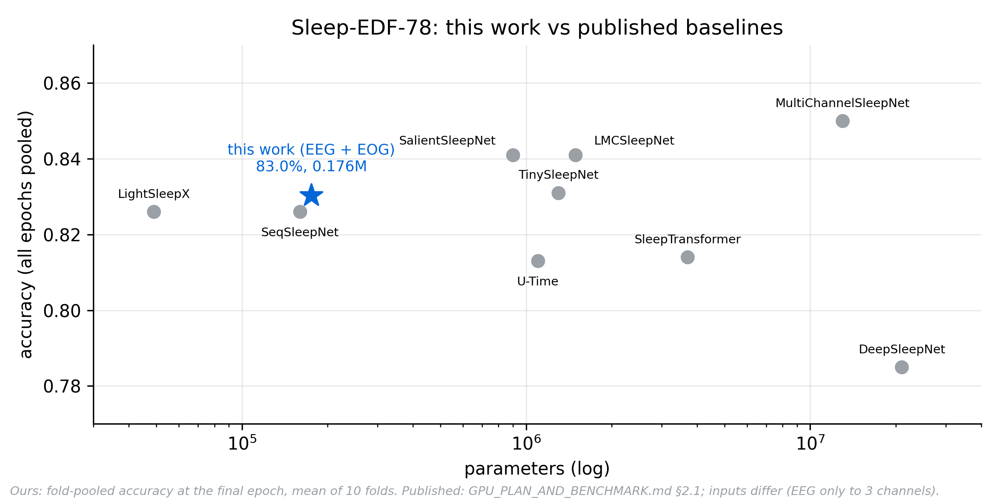

*Fig. 4.12 — B1 against published models (pooled like the papers, final epoch).*

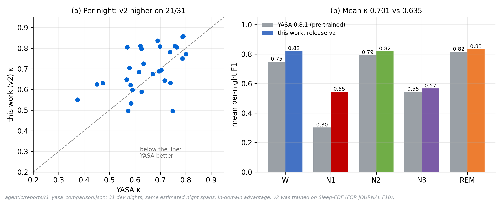

*Fig. 4.19 — Same-night comparison with YASA.*

---

# Chapter 5 — Conclusion and Scope for Further Research

This project built and evaluated, end to end, an offline system that turns a night of EEG + EOG into a
written sleep report whose every claim is checked before release. In the order the work was done:

1. **Knowledge distillation** worked only after the evaluation was made honest and the teacher was made
   genuinely better than the student; an ensemble of diverse compact students provided that teacher, and
   distillation's clearest gain was calibration.
2. **The staging student** (v2, 175,599 parameters, EEG + EOG) reaches κ 0.756 on held-out subjects and
   κ 0.769–0.775 on the standard Sleep-EDF-78 protocol, competitive with models 5–74× larger, and degrades
   gracefully without the eye channel.
3. **The evidence packet** turns predictions into a contract that carries measured trust: per-stage
   reliability, a night-confidence tier that predicts expert agreement without ground truth, and the
   measured reliability of each of 24 derived metrics.
4. **The fine-tuned SLM**, behind a frozen deterministic verifier, released 28/29 verified reports and
   **no flawed report** on the locked test set; the one flawed generation was blocked.
5. **The agentic workflow** delivered the correct, truthful outcome in every fault scenario tested, with
   eight safety invariants holding and byte-identical reruns.
6. **The edge design** fits a Raspberry Pi 5 on paper — about 6–9 minutes and 6–8 GB per night — with
   pre-registered bars for the measurements that would confirm it.

The safe summary claim is: *a 0.18 M-parameter staging model competitive with far larger models, joined
to a local 3 B report model whose output is released only after a deterministic check, with no flawed
report released on held-out data.* "Verified" here means consistent with the packet; clinical usefulness
is not yet shown.

**Scope for further research (Phase II), in priority order:**

1. **Edge measurements:** build the x86 and ARM64 containers, check ARM parity, build the overnight
   replay scheduler and history store (S15), then measure latency, memory, temperature and power on a
   Raspberry Pi 5 with a 7-night soak, and freeze an edge release with one logged evaluation.
2. **External validation** on MESA and CFS, which buys both statistical power and clinical credibility.
3. **A blinded clinician rating** of reports (even 2–3 raters on 20 reports).
4. **Benchmark hygiene:** re-run B1 with an inner early-stopping split and a pooled confusion matrix;
   retrain the teacher on corrected labels or drop the "beats its teacher" claim; check every published
   row against its original paper.
5. **Multi-scorer soft labels** (e.g. DOD-H/DOD-O, five scorers per epoch) so distillation targets reflect
   real inter-scorer uncertainty rather than model disagreement.
6. **A smaller report model** (1–1.5 B) trained to the 5/5 bar, roughly halving edge latency; speculative
   decoding and prompt-prefix caching as lower-risk speed-ups.
7. **A new locked evaluation set**, since the current test set has been used for v2 and cannot evaluate a
   later model.

---

# Appendix A — Code, Configuration and Reproduction

**Repository layout (key paths).**

| Path | Contents |
|---|---|
| `distillation/` | Splits, teacher and student trainers (Kaggle), KD loss, ensemble, calibration, decoder, night confidence, metric reliability, N1 flag, packet builder (v1) |
| `ADDING EOG VERSION - *` | EOG and advanced-student experiments, label audit, v2 integration (v2 packet builder and tables under `PIPELINE INTEGRATION/work_n6adv_packets/`) |
| `ROADMAP B1 - BENCHMARK/` | Standard Sleep-EDF-78 benchmark |
| `report/` | Claim schema, grammar `claims.gbnf`, two-layer verifier, renderer, serializer |
| `reference/`, `student/` | Reference run, training-set builder, LoRA SFT (`kaggle_sft.py`), GGUF models |
| `agentic/` | Agent: core runner, workflows (Path A `packet_report.py`, Path B `edf_report.py`), staging adapters, report backends, release files, tests |
| `AGENTIC AND SIMULATION/` | Agent and edge design, simulation ladder, Dockerfile, acceptance bars |
| `ROADMAP P8 - V2 TEST EVALUATION/` | The single pre-registered test evaluation of release v2 |
| `ui/` | Local web console |
| `CURRENT_RELEASE.md` | Source of truth for the current release and the numbers to cite |

**Reproduction (release v2).**

```bash
# agent tests
python -m pytest agentic/tests -q

# one raw night -> one delivered page (verified report, fallback, review or rejection)
python -m agentic run-edf <night.edf> --release v2

# one prebuilt evidence packet -> page
python -m agentic run-packet <packet.json> --release v2

# local console
python -m ui            # http://127.0.0.1:8000

# figures for this report
python figures/make_figures_v2.py
```

**Core KD loss (`distillation/kd_loss.py`, abridged).**

```python
def distillation_loss(student_logits, teacher_logits, targets, alpha=0.5, T=3.0, weight=None):
    ce = F.cross_entropy(student_logits, targets, weight=weight)
    kl = F.kl_div(F.log_softmax(student_logits / T, dim=-1),
                  F.softmax(teacher_logits / T, dim=-1), reduction="batchmean")
    return alpha * ce + (1 - alpha) * (T ** 2) * kl      # T**2 is mandatory
```

**Release gate (`report/__init__.py`, abridged).**

```python
def verify_report(raw, packet):
    claims, parse_v = parse(raw)              # Layer 0: JSON
    struct_v = verify_structure(claims)       # Layer 1: closed world
    policy = verify_policy(claims, packet)    # Layer 2: values, hedging, coverage
    return VerifyReport(parse_v + struct_v + policy.violations, ...)   # ok iff no violations
```

**Sources of every number.** `CURRENT_RELEASE.md`; `FOR JOURNAL/README.md`;
`ADDING EOG VERSION - FINAL SUMMARY/README.md`; `ROADMAP P8 - V2 TEST EVALUATION/RESULTS.md`;
`ROADMAP R3 - V2 REPORT MODEL/RESULTS.md`; `ROADMAP R2b - V2 VERIFIER ABLATION/RESULTS.md`;
`student/slm_models/SLM_FINDINGS_REPORT.md`; `agentic/STATUS.md`; `agentic/reports/P4_STATUS.md`;
`ROADMAP V2/V3/V4/V5 - */`; `AGENTIC AND SIMULATION/03_EDGE_SIMULATION_PI5.md`;
`deploy/results/throughput.json`; `PROJECT_REPORT.md` (v1 distillation history, stored labels);
v2 tables under `ADDING EOG VERSION - PIPELINE INTEGRATION/work_n6adv_packets/distillation/`.

---

# References

1. B. Kemp, A. H. Zwinderman, B. Tuk, H. A. C. Kamphuisen and J. J. L. Oberyé, "Analysis of a sleep-dependent neuronal feedback loop: the slow-wave microcontinuity of the EEG," *IEEE Trans. Biomed. Eng.*, 47(9), 2000. Sleep-EDF Expanded, PhysioNet.
2. A. L. Goldberger et al., "PhysioBank, PhysioToolkit, and PhysioNet," *Circulation*, 101(23), 2000.
3. R. B. Berry et al., *The AASM Manual for the Scoring of Sleep and Associated Events*, American Academy of Sleep Medicine.
4. G. Hinton, O. Vinyals and J. Dean, "Distilling the Knowledge in a Neural Network," arXiv:1503.02531, 2015.
5. C. Guo, G. Pleiss, Y. Sun and K. Q. Weinberger, "On Calibration of Modern Neural Networks," *ICML*, 2017.
6. M. Sundararajan, A. Taly and Q. Yan, "Axiomatic Attribution for Deep Networks," *ICML*, 2017.
7. A. Supratak, H. Dong, C. Wu and Y. Guo, "DeepSleepNet: a model for automatic sleep stage scoring based on raw single-channel EEG," *IEEE TNSRE*, 2017.
8. A. Supratak and Y. Guo, "TinySleepNet: An Efficient Deep Learning Model for Sleep Stage Scoring based on Raw Single-Channel EEG," *EMBC*, 2020.
9. H. Phan et al., "SeqSleepNet: End-to-End Hierarchical Recurrent Neural Network for Sequence-to-Sequence Automatic Sleep Staging," *IEEE TNSRE*, 2019.
10. H. Phan et al., "SleepTransformer: Automatic Sleep Staging With Interpretability and Uncertainty Quantification," *IEEE TBME*, 2022 (arXiv:2105.11043).
11. E. Eldele et al., "An Attention-Based Deep Learning Approach for Sleep Stage Classification With Single-Channel EEG (AttnSleep)," *IEEE TNSRE*, 2021.
12. M. Perslev et al., "U-Time: A Fully Convolutional Network for Time Series Segmentation Applied to Sleep Staging," *NeurIPS*, 2019.
13. R. Vallat and M. P. Walker, "An open-source, high-performance tool for automated sleep staging (YASA)," *eLife*, 2021.
14. LMCSleepNet — https://pmc.ncbi.nlm.nih.gov/articles/PMC12527093/
15. LightSleepX — https://arxiv.org/html/2609.19062
16. SleepSatelightFTC — https://www.biorxiv.org/content/10.1101/2024.08.02.606301v2.full
17. Micro SleepNet — https://www.ncbi.nlm.nih.gov/pmc/articles/PMC10416229/
18. SleepVLM — https://arxiv.org/abs/2603.26738
19. SleepLM — https://arxiv.org/abs/2602.23605
20. Wearable sleep-guidance SLMs — https://arxiv.org/abs/2609.22463
21. ChatGPT-4o on PSG reports — https://www.ncbi.nlm.nih.gov/pmc/articles/PMC11890353/
22. Seifen et al., locally run LLMs for OSA — https://pmc.ncbi.nlm.nih.gov/articles/PMC12257169/
23. NeuraDock — https://arxiv.org/abs/2606.26519
24. Hybrid EEG report system — https://arxiv.org/abs/2411.09874
25. Insomnia staging benchmark (U-Sleep, YASA) — https://www.ncbi.nlm.nih.gov/pmc/articles/PMC12592834/
26. Somnolyzer in children — https://www.frontiersin.org/journals/medicine/articles/10.3389/fmed.2025.1617530/pdf
27. Cerebra Sleep System, FDA K213007 — https://fda.innolitics.com/device/K213007
28. E. J. Hu et al., "LoRA: Low-Rank Adaptation of Large Language Models," *ICLR*, 2022.
29. Meta AI, Llama 3.2 model card, 2024.
30. G. Gerganov et al., llama.cpp (GGUF, GBNF grammars), https://github.com/ggml-org/llama.cpp
31. SleepKD — knowledge distillation for sleep staging, *IJCAI*, 2023.
32. SleepFM — sleep foundation model (~585,000 h PSG, ~65,000 people), *Nature Medicine*, January 2026.
33. SalientSleepNet — multimodal salient wave detection network for sleep staging (2 EEG + EOG).
34. MultiChannelSleepNet — Transformer-based multi-channel sleep staging (2 EEG + EOG).
35. SleepEEGNet — sleep staging network (2.1 M parameters), as listed in Table 2.1.
36. Dreem 3S headband (Beacon), FDA 2023 — cited as context only.

*Note: entries 31–35 and the published rows in Tables 2.1 and 2.4 were taken from the project's
related-work survey (`COMPARISON WITH EXISTING SYSTEMS/RELATED_WORK.md`); complete author lists and
venues must be checked against the original papers before submission.*
